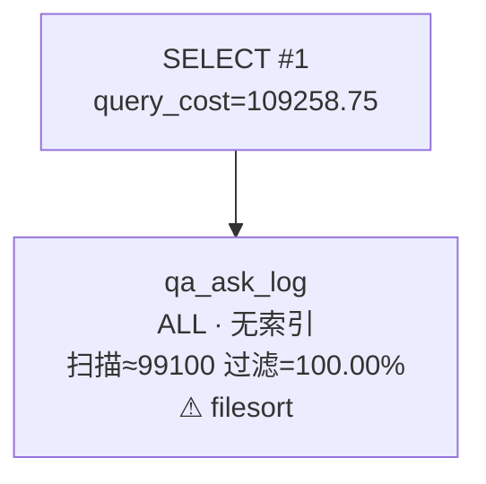
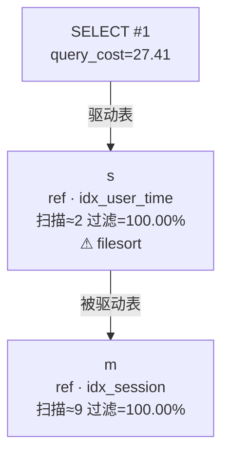

# MySQL 存储引擎与执行计划

> **文档定位**：补齐 2026-09-22 任务清单中的数据库底层项——MySQL 存储结构、存储引擎两类与参数配置、执行计划、查询计划可视化；建表与逐表存储规划见 [数据表存储结构规划](数据表存储结构规划.md)。
> **实测环境**：`mysql:8.0.46`（与 [docker-compose.yml](../backend/docker-compose.yml) 同一镜像），2026-10-27；24 张表由 `backend/db/migration/` 的 9 个脚本建立，物理外键 0 个。
> **可复跑**：命令见 §5.7 与附录 A，现成脚本 [`scripts/explain_checks.sql`](../scripts/explain_checks.sql)，原始计划 JSON 与渲染结果在 [`docs/assets/explain/`](assets/explain/)。

## 1 与既有交付物的核对

任务清单是 8 项，其中建模与建表已有产出，本文只补底层 5 项并逐项对账：

| 任务清单原文 | 状态 | 交付物 |
|---|---|---|
| 查询 MySQL 执行计划 | 本文 §5（含 9 个真实计划） | 本文 + `scripts/explain_checks.sql` |
| MySQL 存储结构 | 本文 §2 | 本文 |
| 重要存储引擎分两类怎么配置；存储引擎参数配置 | 本文 §3、§4 | 本文 |
| 查询计划可视化 | 本文 §6 | [`scripts/explain_plan.py`](../scripts/explain_plan.py) + `docs/assets/explain/` |
| 数据项、数据模型、用建模工具做出来 | ✅ 已完成 | [数据建模](数据建模.md)、[数据建模.dbml](数据建模.dbml)、dbdiagram.io 出图、`docs/assets/er/*.png` |
| 数据规划架构规划出来 | 本文 §7（实例/连接/容量/备份） | 本文 + [数据建模](数据建模.md) §1 |
| 数据表建出来 | ✅ 已完成 | `backend/db/migration/` 24 张表，实测建表通过 |
| 数据表对应存储结构规划出来 | ✅ 本文配套 | [数据表存储结构规划](数据表存储结构规划.md) |

建模工具口径不变：**dbdiagram.io 是网页端 SaaS**，仓库集成的是它的产物（DBML、出图视图、ER 图、迁移脚本），不是工具本身；它只能导出 DDL，落库仍需执行 SQL（详见 [交接文档](交接-物理建表与持久化-Windows.md) §2.5）。

## 2 MySQL 的存储结构

### 2.1 四层体系结构

| 层 | 职责 | 与本项目的关系 |
|---|---|---|
| 连接层 | 连接管理、认证、线程池 | 8 个业务服务各自用 HikariCP 连同一个实例（网关不连库）；`max_connections` 是硬上限 |
| 服务层（SQL Layer） | 解析、优化、执行、内置函数 | `EXPLAIN` 看到的就是这一层的优化结果；全文检索的 `MATCH ... AGAINST` 也在这层解析 |
| 存储引擎层 | 事务、锁、索引、数据读写 | 全库 InnoDB；`SHOW TABLE STATUS` 的 `Engine` 列即此层 |
| 文件系统层 | 表空间、日志、临时文件 | `*.ibd`、redo、undo、binlog、双写缓冲 |

"存储引擎可插拔"是 MySQL 与多数数据库的差别：同一张表可以选择 InnoDB / MyISAM / MEMORY 等，语法统一、实现不同。**本项目所有表固定 InnoDB**，理由见 §3.2。

### 2.2 逻辑存储单元：库 → 表 → 表空间 → 段 → 区 → 页 → 行

| 单元 | 大小/含义 | 要点 |
|---|---|---|
| 库（schema） | `yingxin` | 9 个服务共用一个库，按表前缀分域 |
| 表空间（tablespace） | 每表一个 `.ibd`（`innodb_file_per_table=1`） | 删表能真正还盘；系统表空间 `ibdata1` 只放元数据与部分系统结构 |
| 段（segment） | 按索引组织，一个索引至少两个段（叶子/非叶子） | 每张表有 1 个聚簇索引段 + 每个二级索引各 1 段 |
| 区（extent） | 1 MB = 64 个连续页 | 小表按页分配，超过一定大小后按区分配 |
| 页（page） | **16 KB**（`innodb_page_size`） | 磁盘 I/O 与 Buffer Pool 的最小单位；**建实例后不可改** |
| 行（row） | 见 §2.4 行格式 | 聚簇索引的叶子页直接存整行 |

两个直接影响本项目的结论：

1. **主键决定行的物理顺序**。本项目主键是雪花 ID（趋势递增），插入基本落在 B+ 树右端，页分裂少；若用随机 UUID 作主键，100 万行时随机写入会把页填充率压到 50% 左右。
2. **二级索引叶子只存"索引列 + 主键"**。查非索引列要回表；`EXPLAIN` 的 `Extra=Using index` 表示查询列全在索引里，不用回表（§5.5 Q3 就是这种）。

实测页数（10 万行级表，`mysql.innodb_index_stats`，`stat_name='size'` 单位为页）：

| 表 | 索引 | 总页数 | 叶子页 | 说明 |
|---|---|---:|---:|---|
| `qa_message` | `PRIMARY` | 995 | 962 | 聚簇索引，叶子即整行 |
| `qa_message` | `idx_session` | 353 | 281 | 二级索引，叶子存 `session_id + create_time + id` |
| `checkin_progress` | `uk_user_step` | 225 | 160 | 3 列唯一索引，末位是 `deleted` |
| `qa_ask_log` | `idx_create_time` | 161 | 127 | 单列时间索引 |
| `auth_user` | `uk_student_no` | 9 | 8 | 5,000 行仍在个位数页 |

这些规模下 B+ 树高度为 2–3 层：一次等值查询最多 2–3 次页访问，命中 Buffer Pool 时是纯内存操作。

### 2.3 物理文件构成

实测 `mysql:8.0.46` 数据目录（`/var/lib/mysql`）：

| 文件/目录 | 作用 | 实测/说明 |
|---|---|---|
| `yingxin/*.ibd` | 每表独立表空间（含数据、索引、全文辅助表） | 24 张表各一个 `.ibd`；全文索引额外生成 `fts_*_index_1..6`、`_config`、`_deleted` 等辅助表 |
| `ibdata1` | 系统表空间 | 数据字典、change buffer 等 |
| `undo_001` / `undo_002` | 回滚段（MVCC 与事务回滚） | `innodb_undo_tablespaces=2` |
| `#innodb_redo/` | redo 日志 | 8.0.30+ 用 `innodb_redo_log_capacity` 统一管理，实测 100 MB |
| `#ib_16384_0.dblwr` | 双写缓冲 | 页写入前先落双写文件，防 partial page write |
| `binlog.00000x` | 二进制日志 | 实测 `log_bin=ON`；用于复制与按时间点恢复 |
| `ibtmp1` / `#innodb_temp/` | 临时表空间 | 大排序、`Using temporary` 会用到 |

> 文件体积 ≠ 逻辑数据量：InnoDB 表空间只增不减，`DELETE` 后空间留在表内（`information_schema.tables.data_free`）。归档后要回收空间必须 `OPTIMIZE TABLE`（本质是重建表），见 [数据表存储结构规划](数据表存储结构规划.md) §6。

### 2.4 行格式与溢出页

24 张表实测全部为 `ROW_FORMAT=Dynamic`（MySQL 5.7.9 起的默认值）。Dynamic 的关键行为：

- 变长列（`VARCHAR` / `TEXT` / `JSON`）过长时，整列搬到**溢出页**，行内只留 20 字节指针；
- 因此 `qa_message.content`、`content_article.content`、`qa_question.answer` 这类大字段不会把主行撑爆，但**列表查询一旦 `SELECT *` 就会多读溢出页**；
- 索引列不能是"整列溢出"的列，前缀索引最多 3072 字节（`utf8mb4` 下约 768 字符），本项目索引列都远小于该上限。

## 3 存储引擎：两类与配置方式

### 3.1 两类引擎

课程口径按"是否支持事务"分两类，MySQL 的常见引擎正好落在这条线上：

| 维度 | 事务安全型：InnoDB | 非事务安全型：MyISAM |
|---|---|---|
| 事务 / 回滚 | 支持（ACID） | 不支持 |
| 锁粒度 | 行锁 + MVCC，读写不互相阻塞 | 表锁，写阻塞读 |
| 崩溃恢复 | redo + undo + 双写，自动恢复 | 崩溃后可能表损坏，需 `REPAIR TABLE` |
| 索引结构 | 聚簇索引（主键即数据）+ 二级索引 | 非聚簇，索引与数据文件分离 |
| 外键 | 支持（本项目禁用） | 不支持 |
| 全文索引 | 8.0 支持，可用 ngram 解析中文 | 支持，但中文需额外分词方案 |
| 计数 | `COUNT(*)` 需扫描（MVCC 下不能用缓存计数） | 有行数缓存，`COUNT(*)` 快 |
| 典型场景 | 交易、订单、进度、审计 | 只读历史归档、日志检索（已被 InnoDB 取代） |

其余引擎只作了解：`MEMORY`（内存表、哈希索引、重启即失）、`ARCHIVE`（只插不改、高压缩、无索引）、`CSV`（文本表，便于交换）。它们都不进入本项目选型。

### 3.2 本项目为什么全库 InnoDB

- 报到进度 `checkin_progress` 是**高并发短事务写入**（报到高峰期 5,000 人 × 9 步），需要行锁与崩溃恢复；
- 资助申请、报到凭证有**状态机**，必须能回滚；
- 后台写操作要留审计（`admin_operation_log`），不能因崩溃丢半条记录；
- `qa_question` 的中文全文检索用 InnoDB FULLTEXT + `ngram` 解析器即可（迁移脚本已写 `WITH PARSER ngram`），不需要退回 MyISAM。

核对 SQL 与实测结果：

```sql
SELECT engine, row_format, table_collation, COUNT(*) AS tables
FROM information_schema.tables
WHERE table_schema = 'yingxin'
GROUP BY engine, row_format, table_collation;
-- 实测：InnoDB / Dynamic / utf8mb4_unicode_ci / 24
```

### 3.3 引擎的四个配置入口

| 入口 | 写法 | 作用范围 | 本项目用法 |
|---|---|---|---|
| 服务级默认 | `default_storage_engine=InnoDB`（`my.cnf`、命令行或云端参数组） | 实例全局 | 保持默认值，实测 `InnoDB` |
| 会话级默认 | `SET default_storage_engine=InnoDB;` | 当前连接 | 不使用 |
| **建表级（事实来源）** | `CREATE TABLE ... ENGINE=InnoDB` | 单表 | **24 个迁移脚本全部显式声明**，不依赖服务器默认值 |
| 存量转换 | `ALTER TABLE t ENGINE=InnoDB;` | 单表 | 本项目无 MyISAM 表，无需转换 |

只依赖"服务器默认引擎"是常见事故源：本地默认 InnoDB、某台测试机改过 `my.cnf` 就会建成 MyISAM，事务静默失效。**迁移脚本显式写 `ENGINE=` 是纪律**，评审时按硬要求看。

## 4 存储引擎参数配置（InnoDB 基线）

### 4.1 参数放在哪

| 环境 | 配置位置 | 说明 |
|---|---|---|
| 本地容器 | `backend/docker-compose.yml` 的 `command:` | 现只设 `character-set-server` / `collation-server` / `lower-case-table-names`；内存类参数刻意不设，避免 9 个服务 + 容器抢内存 |
| 云端 | Azure Database for MySQL 的**服务器参数**（参数组） | 改完按提示重启；不写进代码仓库 |
| 应用侧 | `application.yml` | 只放连接串、用户、SSL，**不放引擎参数** |

### 4.2 基线建议值

| 参数 | 本地容器 | 云端（2C4G 起） | 取值理由 |
|---|---|---|---|
| `innodb_buffer_pool_size` | 128 MB（默认） | 物理内存的 50%–70%（如 2 GB） | 最重要的性能参数；本项目热数据 < 200 MB，本地默认够用 |
| `innodb_buffer_pool_instances` | 1 | 2–4 | 仅在 buffer pool ≥ 1 GB 时有意义 |
| `innodb_redo_log_capacity` | 100 MB（默认） | 512 MB–1 GB | 8.0.30+ 统一参数；写高峰（报到）抗突刺 |
| `innodb_flush_log_at_trx_commit` | 1 | 1 | 每次提交刷盘，崩溃不丢事务；课程环境不调低 |
| `innodb_flush_method` | `fsync` | `O_DIRECT`（Linux） | 绕过 OS 缓存，避免双份缓存 |
| `innodb_file_per_table` | ON | ON | 独立表空间，删表可还盘 |
| `innodb_page_size` | 16 KB | 16 KB | **建实例时决定，之后不可改** |
| `innodb_io_capacity` | 200 | 1000+ | 按云盘 IOPS 调；影响刷脏速度 |
| `innodb_lock_wait_timeout` | 50 s | 10–50 s | 业务短事务，等太久说明有锁冲突 |
| `transaction_isolation` | REPEATABLE-READ | REPEATABLE-READ | 默认即可；本项目不依赖 RC 的减少 gap 锁特性 |
| `character_set_server` / `collation_server` | utf8mb4 / utf8mb4_unicode_ci | 同左 | 与建表声明一致，避免隐式转换 |
| `lower_case_table_names` | 1 | 1 | **只在初始化数据目录时生效**，云端已固定为 1 |
| `ngram_token_size` | 2 | 2 | 中文全文检索按 2 字切词；改小会显著增大索引 |
| `max_connections` | 151 | 按规格 | 9 服务 × 连接池上限必须小于该值（见 §7.2） |
| `slow_query_log` / `long_query_time` | OFF / 10 s | ON / 1 s | 上线后开慢日志，作为执行计划治理的输入 |
| `sql_mode` | 严格模式（默认） | 同左 | 禁止静默截断；与云端保持一致 |

### 4.3 实测值（本文验证容器）

```
version=8.0.46  default_storage_engine=InnoDB  innodb_page_size=16384
innodb_buffer_pool_size=512MB（验证时显式指定，compose 默认 128MB）
innodb_redo_log_capacity=100MB  innodb_flush_log_at_trx_commit=1
innodb_flush_method=fsync  transaction_isolation=REPEATABLE-READ
character_set_server=utf8mb4  collation_server=utf8mb4_unicode_ci
lower_case_table_names=1  ngram_token_size=2  max_connections=151
log_bin=ON  innodb_doublewrite=ON  innodb_undo_tablespaces=2
```

### 4.4 变更纪律

- **静态参数**（改完重启才生效）：`innodb_page_size`、`lower_case_table_names`（且后者只对新建数据目录生效）。本地改动需 `docker compose down -v` 重建，**会丢数据**。
- **动态参数**（`SET GLOBAL` 即刻生效、重启失效）：`innodb_buffer_pool_size`、`innodb_io_capacity`、`long_query_time`。云端要写进参数组，否则重启回退。
- 参数变更必须同步本文与 [开发规范](开发规范.md) §10 的版本基线；只改机器不改文档，下次重建容器就漂移。

## 5 执行计划（EXPLAIN）

### 5.1 四种形式

| 形式 | 版本 | 是否执行 | 用途 |
|---|---|---|---|
| `EXPLAIN` | 全版本 | 否 | 表格化估算，日常 review 用 |
| `EXPLAIN FORMAT=TREE` | 8.0.16+ | 否 | 树形，能看出索引条件下推、物化 |
| `EXPLAIN FORMAT=JSON` | 5.6+ | 否 | 机器可读，**本文可视化流程的输入** |
| `EXPLAIN ANALYZE` | 8.0.18+ | **是** | 给出真实行数与耗时，用于核对估算偏差；只对 SELECT 用 |

### 5.2 列含义（结合本项目）

| 列 | 含义 | 本项目关注点 |
|---|---|---|
| `id` | 查询块编号 | 子查询/UNION 才有多个值 |
| `select_type` | SIMPLE / PRIMARY / SUBQUERY / DERIVED / UNION | 出现 `DERIVED` 要留意物化成本 |
| `table` | 表名或别名 | join 时按出现顺序是驱动→被驱动 |
| `partitions` | 命中的分区 | 本项目不分区，恒为 `NULL` |
| `type` | 访问类型（§5.3） | **最重要的列** |
| `possible_keys` | 候选索引 | 候选多但 `key` 为 `NULL` 说明优化器认为全表更快 |
| `key` | 实际使用的索引 | `NULL` = 没用索引 |
| `key_len` | 使用到的索引字节数 | 组合索引只用了前缀列时明显偏小 |
| `ref` | 与索引比较的对象（const/列名） | `const` 表示等值常量 |
| `rows` | 估算扫描行数 | 与业务量级不符说明统计信息过期 |
| `filtered` | 扫描后剩余百分比 | 很低说明索引选择性差 |
| `Extra` | 补充动作（§5.4） | `Using filesort` / `Using temporary` 是重点 |

### 5.3 type 等级与验收底线

从好到差：`system > const > eq_ref > ref > fulltext > range > index > ALL`。

| type | 含义 | 本项目例子 | 判定 |
|---|---|---|---|
| `const` | 唯一索引等值，最多一行 | 学号登录（Q1） | 优 |
| `eq_ref` | 被驱动表按唯一键关联 | 按主键取单条 | 优 |
| `ref` | 非唯一索引等值 | 用户报到进度（Q2）、会话消息（Q5） | 良 |
| `fulltext` | 全文索引 | 问答检索（Q4） | 可接受 |
| `range` | 索引范围扫描 | 时间范围翻页（Q7 改写后） | 良 |
| `index` | 扫整个索引 | 低基数列过滤（Q6） | 差，需确认数据量 |
| `ALL` | 全表扫描 | 深翻页（Q7 改写前） | **核心接口不允许** |

**底线**：面向学生的核心接口（登录、报到、问答、导航）不允许 `ALL`；日志/看板类查询允许 `range`/`index`，但必须配合归档或预聚合。行数 < 100 的小表（模板、配置）全表扫描反而更快，不在此列。

### 5.4 Extra 的六个信号

| Extra | 含义 | 处理 |
|---|---|---|
| `Using index` | 覆盖索引，不回表 | 好，尽量保持 |
| `Using index condition` | 索引条件下推（ICP） | 好；`deleted=0` 在索引里过滤就是它 |
| `Using where` | 取行后再过滤 | 正常；配合大 `rows` 就要警惕 |
| `Using filesort` | 需要额外排序 | 检查 `ORDER BY` 能否借索引顺序 |
| `Using temporary` | 用了临时表 | 常见于 `GROUP BY` + 跨表排序；数据量大时落盘 |
| `Backward index scan` | 反向扫索引 | 好，`ORDER BY ... DESC` 正好用上 |

### 5.5 本项目 9 个真实计划

以下结果来自 2026-10-27 的验证容器（24 张表 + 合成数据：5,000 用户、45,000 条报到进度、10 万条消息、10 万条日志）。**结论看 `type`/`key`，具体 `rows` 随数据分布变化**。

**Q1 学号登录** —— `type=const`、`key=uk_student_no`、`rows=1`：

```
| id | select_type | table     | type  | key           | key_len | ref   | rows | filtered | Extra |
|  1 | SIMPLE      | auth_user | const | uk_student_no | 131     | const |    1 |   100.00 | NULL  |
```

`key_len=131` = `varchar(32)` 的 128 字节（utf8mb4 最多 4 字节/字符）+ 1 字节长度 + 2 字节可空标记。唯一索引等值最多一行，这条路径是登录接口应有的样子。

**Q2 学生报到进度** —— `type=ref`、`key=uk_user_step`、`rows=9`，`Extra=Using index condition`：

```
| id | select_type | table            | type | key          | key_len | ref   | rows | filtered | Extra                 |
|  1 | SIMPLE      | checkin_progress | ref  | uk_user_step | 8       | const |    9 |    10.00 | Using index condition |
```

`uk_user_step(user_id, step_code, deleted)` 只用到了第一列 `user_id`（`key_len=8`），一个学生 9 条步骤，符合预期。`deleted` 在索引里，作为索引条件下推过滤，不用回表。

**Q3 按步骤统计** —— `key=idx_step_status`、`rows≈5000`、`Extra=Using index`：

```
| id | SIMPLE | checkin_progress | ref | idx_step_status | 130 | const | 5000 | 100.00 | Using index |
```

这是**覆盖索引**：`step_code`、`status` 都在索引里，`COUNT(*)` 不需要回表。代价是要扫 5,000 条索引项——统计类查询应走 Redis 计数或预聚合，不要每次实时扫。

**Q4 中文全文检索** —— `type=fulltext`、`key=idx_question`、`Extra=Using where; Ft_hints: no_ranking`：

```
EXPLAIN ANALYZE ... AGAINST('被子' IN BOOLEAN MODE)
-> Filter: ((status = 1) and (match ... against ('被子' in boolean mode)))
     (cost=0.26 rows=0.1) (actual time=0.033..0.265 rows=100 loops=1)
  -> Full-text index search on qa_question using idx_question
     (cost=0.26 rows=1) (actual time=0.032..0.254 rows=100 loops=1)
```

`rows=1` 是全文索引的固定估算，**不要用它判断规模**；`EXPLAIN ANALYZE` 的真实命中是 100 行、约 0.3 ms。前提是索引声明了 `WITH PARSER ngram` 且 `ngram_token_size=2`，否则中文会被整体当一个词，检索不到。另需注意客户端字符集：用 `mysql ... < x.sql` 灌入含中文的 SQL 时必须带 `--default-character-set=utf8mb4`，否则检索词会变成 `?`（见附录 A）。

**Q5 会话消息倒序 20 条** —— `type=ref`、`Backward index scan`、无 filesort：

```
| qa_message | ref | idx_session | 8 | const | 10 | 100.00 | Backward index scan |
```

`idx_session(session_id, create_time)` 天然满足"同一会话内按时间倒序"，优化器反向扫索引后 `LIMIT 20` 立即停止，实际 0.1 ms。

**Q6 反例：低基数列单独过滤** —— `type=index`、扫 45,784 行：

```
SELECT id, user_id FROM checkin_progress WHERE status = 1;
| checkin_progress | index | idx_user_status | 9 | NULL | 45784 | 10.00 | Using where; Using index |
```

`status` 只有 3 个取值，项目刻意不建单列索引。这里优化器选了覆盖索引全扫，本质仍是"读全表"。**结论：按状态列表查询必须带其他高选择性条件（用户、时间、批次）**，或改走组合索引且等值列在前（`idx_status_time(status, create_time)` 是报修单的做法）。

**Q7 深翻页 vs 游标翻页**（同一张 10 万行日志表）：

```
-- 反例：0.105 s
EXPLAIN SELECT * FROM qa_ask_log ORDER BY create_time LIMIT 100000, 20;
| qa_ask_log | ALL | NULL | NULL | NULL | 99100 | 100.00 | Using filesort |

-- 改写：0.001 s（约 100 倍）
EXPLAIN SELECT * FROM qa_ask_log
WHERE create_time > '2026-09-20 00:00:00' ORDER BY create_time LIMIT 20;
| qa_ask_log | range | idx_create_time | 7 | NULL | 49550 | 100.00 | Using index condition |
```

`LIMIT offset, n` 要先数过 offset 行再丢弃，offset 越大越慢，而且可能放弃索引改走 filesort。后台列表统一用**游标（上次的最大/最小 `create_time`）**，不要用页码翻深页。

**Q8 跨表逻辑关联** —— 驱动表 `ref`、被驱动表 `ref`，但有 `Using temporary; Using filesort`：

```
| s | ref | idx_user_time | 8 | const | 2 | 100.00 | Using index; Using temporary; Using filesort |
| m | ref | idx_session   | 8 | s.id  | 9 | 100.00 | NULL |
```

库内没有外键，但应用层仍会 join。`ORDER BY m.create_time` 是第二张表的列，无法借用第一张表的索引顺序，只能排序。若该列表是高频页面，改为"先按会话取消息 id 列表，再按 id 批量查"，或把排序键冗余到驱动表。

**Q9 埋点看板聚合** —— `key=idx_type_time`、`Extra=Using where; Using index`：

```
SELECT event_type, COUNT(*) FROM admin_behavior_event
WHERE event_time >= '2026-09-01' AND event_time < '2026-09-08'
GROUP BY event_type;
| admin_behavior_event | index | idx_type_time | 8 | NULL | 99288 | 11.11 | Using where; Using index |
```

组合索引是 `(event_type, event_time)`，而查询按 `event_time` 范围过滤、按 `event_type` 分组，**列序与访问方式不匹配**，只能扫整个索引。看板类查询的正确做法是读预聚合表/缓存（[数据建模](数据建模.md) §7.2），不要直接扫明细。

> 复跑以上 9 条：`scripts/explain_checks.sql`；原始 JSON 与渲染后的 Mermaid 在 `docs/assets/explain/`。

### 5.6 执行计划判读清单（提 PR / 上线前）

1. 核心查询的 `type` 不劣于 `range`，且 `key` 不为 `NULL`；
2. `rows` 与业务量级相符（明显偏小多半是统计信息过期，先 `ANALYZE TABLE`）；
3. `filtered` 很低（如 10%）说明索引选择性差，考虑组合索引或改查询条件；
4. `Extra` 不应出现 `Using filesort` / `Using temporary`，除非能证明数据量小；
5. 组合索引检查列序：等值列在前、范围列在后（Q9 就是反例）；
6. 估算与真实差异大时用 `EXPLAIN ANALYZE` 复核（只对 SELECT）；
7. 新增/修改索引必须有对应的迁移脚本，并同步 [数据建模](数据建模.md) §3 与附录 B.3。

### 5.7 实测环境与可复现性

| 项 | 值 |
|---|---|
| 镜像/版本 | `mysql:8.0.46`（与 compose、云端 8.0.46 一致） |
| 端口 | 临时容器 3307（避开本机禅道的 3306） |
| 数据规模 | 5,000 用户 / 5,000 身份 / 45,000 报到进度 / 10 万消息 / 10 万提问日志 / 10 万埋点 |
| 建表 | 按版本号顺序执行 9 个迁移脚本，24 表、0 外键 |
| Buffer Pool | 512 MB（验证时显式指定） |

## 6 查询计划可视化

### 6.1 三种手段

| 手段 | 优点 | 局限 | 本项目定位 |
|---|---|---|---|
| MySQL Workbench Visual Explain | 图形直观，鼠标悬停看细节 | 桌面端、难进仓库/CI、截图易过期 | 课堂演示可用，不作交付物 |
| `EXPLAIN FORMAT=JSON` + 本仓脚本 | 纯文本、可 diff、Mermaid 可渲染 | 只有估算，没有真实耗时 | **主流程**，产物随代码 review |
| 慢日志 + `performance_schema` | 反映真实线上负载 | 需开启并等待采样 | 上线后补充，见 §4.2 |

### 6.2 本仓可视化流程

```bash
# 1) 导出计划（-r -N --raw 缺一不可：否则换行被转义成字面 \n，JSON 会解析失败）
mysql -h127.0.0.1 -P3306 -uyingxin -p yingxin -r -N --raw \
  -e "EXPLAIN FORMAT=JSON SELECT ..." > plan.json

# 2) 渲染：输出 Markdown 表格 + Mermaid 流程图 + 判读提示
python3 scripts/explain_plan.py plan.json

# 3) 只要图（贴进任意 Markdown）
python3 scripts/explain_plan.py plan.json --mermaid-only > plan.mmd
```

脚本只依赖标准库，识别 `query_block` / `nested_loop` / `ordering_operation` / `grouping_operation` / 物化子查询 / UNION；遇到未知节点不报错。

### 6.3 渲染示例

**Q7 反例（深翻页）** —— 节点里直接标出 `ALL`、无索引、`filesort`：



**Q8 join** —— 驱动表/被驱动表与临时表排序一目了然：



其余 4 个计划的渲染结果见 `docs/assets/explain/plan-0*.md`，原始 JSON 同名 `.json`。

### 6.4 使用注意

- 计划随统计信息变化：数据量或分布大变后要重新导出，不要提交过期 JSON 当证据；
- `EXPLAIN FORMAT=JSON` 的 `rows` 是估算，**不要拿它当性能结论**；
- 含真实学号/手机号的 SQL 不要提交到仓库，示例一律用虚构值；
- 表别名会出现在 `table_name` 里（join 示例中的 `s`/`m`），判读时对照 SQL 的 `AS`。

## 7 数据规划架构

本节回答"数据放在哪、怎么连、能撑多久"，与 [数据建模](数据建模.md) §1 的表设计是同一套口径。

### 7.1 实例与库的划分

| 项 | 规划 | 依据 |
|---|---|---|
| 实例 | 单实例（本地容器 / 云端 Azure Flexible Server） | 课程规模；9 服务共库可避免分布式事务 |
| 库 | `yingxin` 单库 | [开发规范](开发规范.md) 既定语 |
| 表归属 | 9 个服务前缀，表名即归属 | [数据建模](数据建模.md) §1.1 |
| 外键 | 0 个，应用层保证引用完整性 | 同上 §6；DI-1–DI-22 |
| 字符集/排序 | utf8mb4 / utf8mb4_unicode_ci | 与云端一致，中文与 emoji 均可存 |
| 时区 | 连接串 `serverTimezone=Asia/Shanghai`，`DATETIME(3)` | 应用与库口径一致 |

**单库不等于单事务**：跨服务写（如报到完成后发推送）仍是"各自提交 + 业务补偿"，不能指望数据库事务兜底。

### 7.2 连接与访问路径

- 每个业务服务独立 HikariCP，`maximum-pool-size: 10`（8 个连库服务合计 80）< `max_connections=151`，留出运维余量；网关不连库；
- 读多写少的公共数据（问答、内容、服务信息）走 Redis 缓存，热点不落库；
- 一期**不做读写分离**：单实例 + 缓存足够支撑 5,000 新生；引入副本会带来说延迟与一致性口径问题；
- 所有 SQL 经 MyBatis-Plus，分页插件强制方言 MySQL，禁止手写 `LIMIT` 拼接用户输入。

### 7.3 容量与增长

- 单批 5,000 新生的实际数据量约 **126 MB**（逐表估算见 [数据表存储结构规划](数据表存储结构规划.md) §3），其中消息、日志、报到进度占 80%；
- 用户/身份/凭证/进度随批次线性增长，三年 3 批约 **380 MB**；
- 日志与消息按 [数据建模](数据建模.md) §7.3 归档，不随年份无限累积；
- 预算：**在线库 < 5 GB**，单表 < 1,000 万行；超过这个量级再考虑分区/分库。

### 7.4 备份与恢复

| 场景 | 做法 |
|---|---|
| 云端 | 平台自动备份（保留 7 天）+ 每日逻辑备份（`mysqldump --single-transaction`） |
| 本地 | 数据可丢：`docker compose down -v` 后按迁移脚本重建；需要保留时导出 SQL |
| 迁移脚本 | 是**源码**，与代码同版本管理；恢复不以"某台机器的数据目录"为准 |

### 7.5 归档对存储结构的影响

归档不是 `DELETE` 完就结束：InnoDB 表空间只增不减，删除后要 `OPTIMIZE TABLE`（重建表）才还盘；归档表按年/月建独立表，避免主表持续膨胀。具体表与节奏见 [数据表存储结构规划](数据表存储结构规划.md) §6。

## 8 本轮的边界

- **未做分区**：一期单表 < 10 万行，分区收益低于运维成本；分区键还必须进主键/唯一键，与雪花主键冲突。
- **未做读写分离与高可用**：课程环境单实例；云端由平台保证可用性。
- **未接 Flyway**：迁移仍按版本号手工执行（[交接文档](交接-物理建表与持久化-Windows.md) §2.3）。
- **参数基线未压测**：§4.2 是按容量与课程规模给的保守值，真实负载后需校准。
- **实测数据是合成数据**：只用于验证索引与计划形态，不代表真实学生数据（C-6 约束）。

## 附录 A 复跑步骤

```bash
# 1) 起一个干净的 MySQL（端口 3307，避开本机 3306）
docker run -d --name yingxin-mysql-verify \
  -e MYSQL_ROOT_PASSWORD=root123 -e MYSQL_DATABASE=yingxin \
  -e MYSQL_USER=yingxin -e MYSQL_PASSWORD=yingxin123 \
  -p 3307:3306 \
  -v "$PWD/backend/db/migration:/migrations:ro" \
  mysql:8.0.46 \
  --character-set-server=utf8mb4 --collation-server=utf8mb4_unicode_ci \
  --lower-case-table-names=1 --innodb-buffer-pool-size=512M

# 2) 按版本号顺序建表（9 个脚本 → 24 张表）
docker exec yingxin-mysql-verify bash -lc \
  'for f in $(ls /migrations/V*.sql | sort); do mysql -uroot -proot123 yingxin < "$f"; done'

# 3) 核对执行计划（空库也能跑；要复现文档数字需先灌合成数据）
#    必须带 --default-character-set=utf8mb4：脚本里 Q4 含中文检索词，
#    客户端默认 latin1/gbk 时中文会变成 '?'，全文检索命中 0 行
docker exec -i yingxin-mysql-verify mysql -uroot -proot123 \
  --default-character-set=utf8mb4 yingxin < scripts/explain_checks.sql

# 4) 生成可视化
mysql -h127.0.0.1 -P3307 -uyingxin -pyingxin123 yingxin -r -N --raw \
  -e "EXPLAIN FORMAT=JSON SELECT ..." > plan.json
python3 scripts/explain_plan.py plan.json

# 5) 用完清理
docker rm -f yingxin-mysql-verify
```

## 附录 B 参考

- [数据建模](数据建模.md)：§1 表设计约定、§3 字段、§6 完整性与无外键对策、§7 数据量与归档、§9 迁移与建模落地
- [数据表存储结构规划](数据表存储结构规划.md)：24 张表的引擎/行格式/索引/页数/容量
- [开发规范](开发规范.md)：§5 数据与迁移约定、§10 环境与版本基线
- MySQL 8.0 Reference Manual：Optimization（EXPLAIN Output Format）、InnoDB Storage Engine、Full-Text Search with ngram
