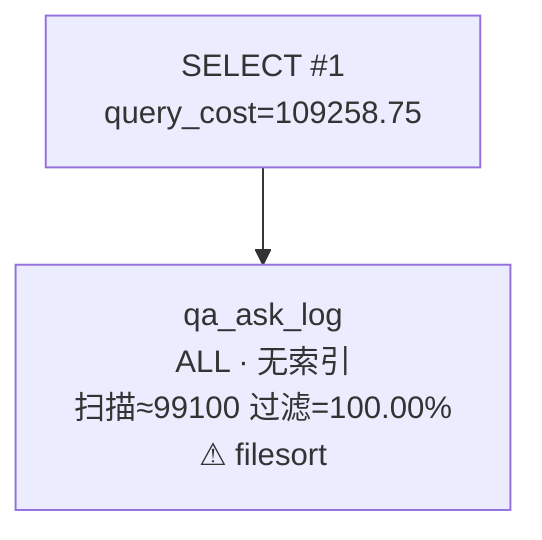

## 执行计划

| 顺序 | 表 | 访问类型 | 使用的索引 | 扫描行数 | 过滤率 | 判读 |
|---:|---|---|---|---:|---:|---|
| 1 | `qa_ask_log` | ALL | 无索引 | 99100 | 100.00% | filesort |

**判读提示**：
- `qa_ask_log` 使用 ALL：全表/全索引扫描，行数增长后必然变慢，需核对过滤条件能否命中索引。
- `qa_ask_log` 出现 filesort：排序/临时表在内存不足时会落盘，需核对排序字段是否能借索引有序性。
