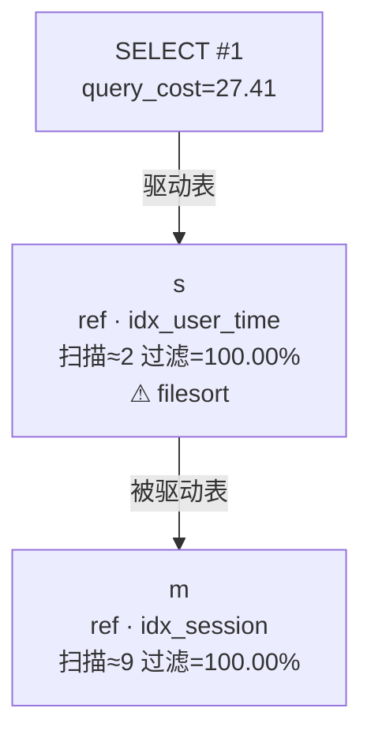

## 执行计划

| 顺序 | 表 | 访问类型 | 使用的索引 | 扫描行数 | 过滤率 | 判读 |
|---:|---|---|---|---:|---:|---|
| 1 | `s` | ref | idx_user_time | 2 | 100.00% | filesort |
| 2 | `m` | ref | idx_session | 9 | 100.00% | — |

**判读提示**：
- `s` 出现 filesort：排序/临时表在内存不足时会落盘，需核对排序字段是否能借索引有序性。
