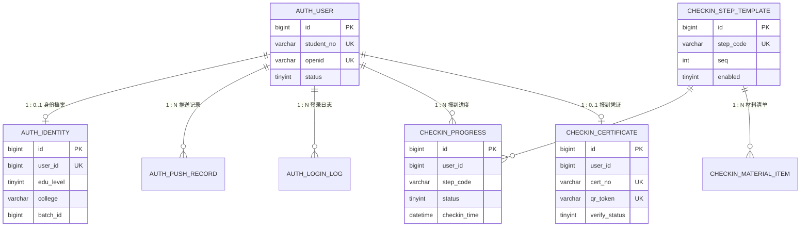
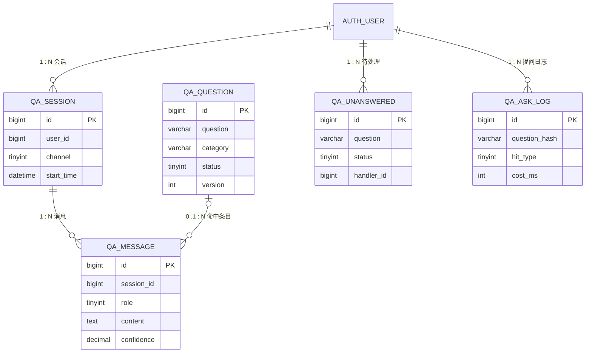
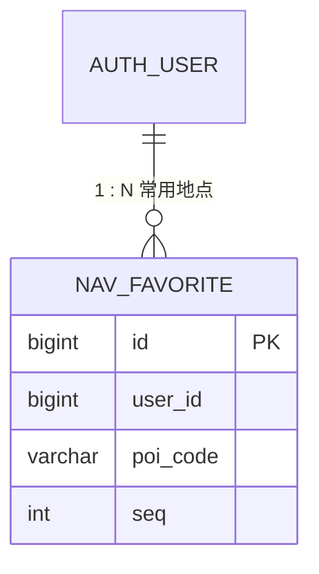
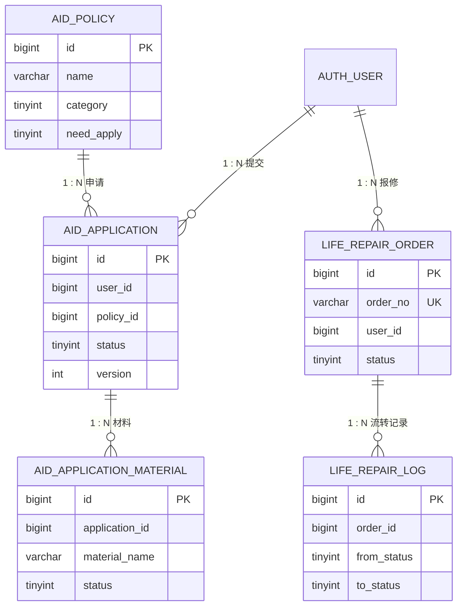
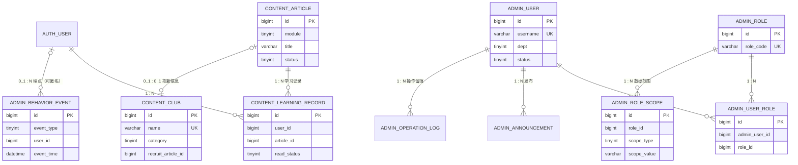

# 数据建模文档

> 版本 v1.0 ｜ 状态：设计阶段（表结构尚未落地，建表按 §9 执行）
> 读者：**写代码的成员**。本文给出可直接落库的表、字段与约束；字段长度与参数取值见
> [需求分析文档](需求分析文档.md) §7.1.4，完整性规则编号（DI-1–DI-22）见该文档 §7.2。
> 与 [开发规范](开发规范.md) 第 5 章配套使用（命名、通用字段、禁物理外键、Flyway 迁移、敏感数据），**冲突时以《开发规范》为准**。
> 快速定位：表清单 §2 ｜ 字段定义 §3 ｜ 关系与 ER 图 §4 ｜ 唯一键与状态机 §5 ｜ 完整性对策 §6 ｜ 量级与保留 §7 ｜ 安全与权限 §8 ｜ 落地注意事项 §9 ｜ 数据字典附录 B。

---

## 1 建模约定

### 1.1 服务与表前缀

9 个服务共用一个库 `yingxin`，按服务前缀分表（NFR-2.3 同库规避分布式事务）：

| 服务 | 端口 | 表前缀 | 承载需求 |
|---|---|---|---|
| auth-service | 8100 | `auth_` | FR-1 身份核验与个性化迎新 |
| checkin-service | 8102 | `checkin_` | FR-2 报到全流程导引 |
| qa-service | 8101 | `qa_` | FR-3 智能问答 |
| navigation-service | 8103 | `nav_` | FR-4 校园导航 |
| aid-service | 8104 | `aid_` | FR-5 资助与绿色通道 |
| life-service | 8105 | `life_` | FR-6 生活服务聚合 |
| content-service | 8106 | `content_` | FR-7 安全教育 / FR-8 社团与入学适应 |
| admin-service | 8107 | `admin_` | FR-9 管理后台（+ 平台埋点） |

### 1.2 命名与类型总约定

- 表名、字段名**全小写 + 下划线**（本地 `lower_case_table_names=1` 与云端一致，写驼峰会在云端报"表不存在"）；
- 表名 = `<服务前缀><实体复数>`，例 `qa_question`；
- 统一类型口径：

| 用途 | 类型 | 说明 |
|---|---|---|
| 主键 | `BIGINT` | 雪花 ID，**不用自增**（避免暴露规模、便于后续分库） |
| 逻辑引用（跨表/跨服务） | `BIGINT` | 只存 id，**不建物理外键**，存在性由应用层保证 |
| 短文本 | `VARCHAR(n)` | 按业务上限取整，禁止一律 `VARCHAR(255)` |
| 定长编码 | `CHAR(n)` | 长度固定的编码值：指纹/校验值（SHA-256 → `CHAR(64)`）、MD5（`CHAR(32)`）；**密文列一律 `VARCHAR`**（密文长度不固定） |
| 长文本/富文本 | `TEXT` / `MEDIUMTEXT` | 富文本存 HTML 需前端过滤（XSS） |
| 结构化扩展 | `JSON` | 仅用于规则、扩展属性等弱结构化数据，可检索字段必须单独成列 |
| 时间 | `DATETIME(3)` | 毫秒精度；统一按 `Asia/Shanghai` 读写 |
| 日期 | `DATE` | 仅"日期"语义时使用 |
| 布尔 | `TINYINT(1)` | 0/1，不用 `BIT` |
| 枚举 | `TINYINT` / `VARCHAR(16)` | 用编码 + 字典说明，**不用 `ENUM` 类型**（改值要 DDL） |
| 金额 | `DECIMAL(10,2)` | 禁止浮点 |
| 经纬度 | `DECIMAL(10,7)` | 约 1cm 精度 |
| 比例/评分 | `DECIMAL(5,2)` | 百分制 |

### 1.3 通用字段（每张表都有，下文不再重复列出）

| 字段 | 类型 | 约束 | 说明 |
|---|---|---|---|
| `id` | BIGINT | PK | 雪花 ID |
| `create_time` | DATETIME(3) | NOT NULL | 持久层自动填充 |
| `update_time` | DATETIME(3) | NOT NULL | 持久层自动填充 |
| `create_by` / `update_by` | BIGINT | NULL | 操作人 id，系统写入为 0 |
| `deleted` | BIGINT | NOT NULL DEFAULT 0 | 逻辑删除：0 = 未删除；**删除时写入本行 `id`**（见 §5.1） |

> 默认字符集 `utf8mb4` / `utf8mb4_unicode_ci`；引擎 InnoDB；**禁止物理外键**。

### 1.4 与通用数据库设计规范的偏离说明

本文的设计经过**通用数据库设计规范**（SkillHub 的 `design-db` 技能：命名 / 必备字段 / 数据类型 / 索引 / 约束 / 范式 / 关系 / 软删除 / 迁移）复核，
**已采纳**的要求：定长编码值用 `CHAR(n)`（§1.2）、引用列必须建索引（§3 各表）、审计表保存变更前后值（§3.8）、迁移前向兼容（[开发规范](开发规范.md) §5.3）。
以下是**有意偏离**，均已在别处固化，评审时按"有意为之"看，不要当作疏漏：

| 项 | 通用规范建议 | 本项目做法 | 偏离理由 |
|---|---|---|---|
| 表名 | 复数（`orders`） | **单数**（`qa_question`） | 项目已有 `<服务前缀>_<实体>` 口径（§1.1），单数与实体一一对应；批量改名会牵动文档、DBML 与已有代码，收益极低 |
| 主键 | 自增 `BIGINT` 或 UUID 字符串 | **雪花 ID（`BIGINT`，非自增）** | 不暴露业务规模、便于后续分库；由持久层统一生成（业务代码不得自己拼 id） |
| 审计字段名 | `created_at` / `updated_at` / `created_by` / `updated_by` | `create_time` / `update_time` / `create_by` / `update_by` | 通用规范允许"从项目现有约定提取"；全库已统一，**禁止混用两种风格** |
| 时间默认值 | DDL 写 `DEFAULT CURRENT_TIMESTAMP` | 由持久层填充，DDL 不写 `DEFAULT` | 避免应用时区与库时区不一致；`DATETIME(3)` 统一按 `Asia/Shanghai`（§1.2） |
| 软删除 | `is_deleted TINYINT` 或 `deleted_at DATETIME` | **`deleted BIGINT`**（0 = 未删，删除时写入行 id） | 与唯一索引共存：唯一索引末位带 `deleted` 后，仍支持"删除后重建同业务键记录"（§5.1） |
| 索引命名 | `idx_{表}_{列}` | `idx_{列}` / `uk_{列}`（表内唯一） | MySQL 索引名本就按表作用域，省略表名更短且不歧义；全库统一（附录 B.3） |
| `CHECK` 约束 | 用 `CHECK` 限定枚举与范围 | **不用 `CHECK`** | 迁移与调试成本；枚举统一由码表（附录 B.2）+ 应用层校验保证（DI-16） |
| 金额精度 | `DECIMAL(18,2)` | `DECIMAL(10,2)` | 取值上限已在 [需求分析文档](需求分析文档.md) §7.1.4 固定（≤ 99,999,999.99），够用且省空间 |
| 迁移文件命名 | `V1.0.0__init_schema.sql` | `V<yyyyMMddHHmm>__<服务简称>_<说明>.sql` | 多人并行时版本号必然撞车，时间戳单调递增（[开发规范](开发规范.md) §5.3） |
| 索引密度 | 每个 WHERE/JOIN 列都建索引 | 日志类小表与配置类小表**豁免** | `qa_ask_log` / `admin_behavior_event` 写入密集，只保留 2 个索引；`content_file`、`life_service_info` 等行数 < 100，索引价值趋零（附录 B.3） |

> 结论：可执行的差异都在上表；**如需改为完全遵循通用规范，唯一值得做的是索引命名加表名前缀**（纯重命名，无数据影响），其余改动成本与收益不成比例。

### 1.5 状态字段的取值约定

所有状态字段用 `TINYINT` 编码，状态流转规则集中写在 §5.5，**不允许出现未登记的状态值**。

---

## 2 数据实体（表清单）

### 2.1 实体清单（33 张表）

> **地图数据不入库**（2026-09-28 决定）：校园 POI 与路网属静态只读数据，改为 **JSON 资源文件**随代码版本管理（见本节"静态资源"表），
> 因此取消 `nav_poi` / `nav_node` / `nav_edge` **三张表**，DR-11、DR-12 由"表实体"转为"静态资源"。

类型说明：**主数据**=长期存在的基础数据；**业务数据**=流程产生；**配置数据**=后台维护的模板/规则；**日志数据**=只追加不修改；
**缓存**=Redis 结构，不建表；**静态资源**=随代码版本管理的只读文件，同样不建表。

| # | 实体（表名） | 归属服务 | 类型 | 来源 DR | 对应需求 | 谁产生 | 谁消费 |
|---|---|---|---|---|---|---|---|
| 1 | `auth_user` | auth | 主数据 | DR-1 | F1.1、F1.2、F1.9 | 登录/注册 | 全部服务（经 Header 传 id） |
| 2 | `auth_identity` | auth | 主数据 | DR-2 | F1.4–F1.6 | 身份解析 | 报到、资助、后台统计 |
| 3 | `auth_push_record` | auth | 日志 | 新增 | F1.7 | 待办推送 | 学生端、后台 |
| 4 | `auth_login_log` | auth | 日志 | 新增 | F1.8、NFR-4.6 | 每次登录 | 运维、安全审计 |
| 5 | `checkin_step_template` | checkin | 配置 | DR-4 | F2.1–F2.3 | 管理员 | 学生端引导 |
| 6 | `checkin_material_item` | checkin | 配置 | DR-6 | F2.6 | 管理员 | 学生端、异常指引 |
| 7 | `checkin_progress` | checkin | 业务 | DR-5 | F2.2、F2.4、F2.5 | 学生打卡 | 进度总览、后台统计 |
| 8 | `checkin_certificate` | checkin | 业务 | 新增 | F2.10 | 报到完成时 | 现场核销、后台 |
| 9 | `checkin_exception_guide` | checkin | 配置 | 新增 | F2.9 | 管理员 | 学生端异常分支 |
| 10 | `qa_question` | qa | 主数据 | DR-7 | F3.1–F3.4 | 管理员 | 问答检索 |
| 11 | `qa_session` | qa | 业务 | DR-8 | F3.5、F3.13 | 会话开始 | 多轮对话、后台 |
| 12 | `qa_message` | qa | 业务 | DR-8 | F3.7、F3.13 | 每轮问答 | 上下文、后台 |
| 13 | `qa_unanswered` | qa | 业务 | DR-9 | F3.11 | 低置信度命中 | 志愿者/辅导员、后台 |
| 14 | `qa_ask_log` | qa | 日志 | 新增 | F9.6、F3.10 | 每次提问 | 数据看板、热门问题 |
| 15 | `nav_favorite` | navigation | 业务 | DR-26 | F4.10 | 学生 | 快捷导航 |
| 16 | `aid_policy` | aid | 配置 | DR-13 | F5.1、F5.2、F5.6 | 管理员 | 政策查询、匹配 |
| 17 | `aid_application` | aid | 业务 | DR-14 | F5.5、F5.7、F5.8 | 学生提交 | 审核、后台统计 |
| 18 | `aid_application_material` | aid | 业务 | DR-14 | F5.3、F5.5 | 学生上传 | 审核 |
| 19 | `life_repair_order` | life | 业务 | DR-15 | F6.1 | 学生提交 | 后勤、学生查询 |
| 20 | `life_repair_log` | life | 日志 | DR-27 | F6.1 | 流转动作 | 进度追溯 |
| 21 | `life_service_info` | life | 配置 | DR-28 | F6.3–F6.10 | 管理员 | 生活服务查询 |
| 22 | `content_article` | content | 配置 | DR-16 | F7.1–F7.4、F8.2–F8.4 | 管理员 | 安全/入学教育/招新 |
| 23 | `content_club` | content | 配置 | DR-29 | F8.1 | 管理员 | 社团介绍 |
| 24 | `content_learning_record` | content | 业务 | DR-30 | F7.6、F7.3 | 学生阅读/答题 | 学习状态、后台 |
| 25 | `content_file` | content | 配置 | DR-31 | F8.5 | 管理员 | 表格下载 |
| 26 | `admin_user` | admin | 主数据 | DR-18 | F9.1 | 管理员创建 | 后台登录、审计 |
| 27 | `admin_role` | admin | 主数据 | DR-18 | F9.2 | 管理员 | 权限判定 |
| 28 | `admin_user_role` | admin | 主数据 | DR-18 | F9.2 | 管理员 | 权限判定 |
| 29 | `admin_role_scope` | admin | 主数据 | DR-32 | F9.2、F9.7 | 管理员 | 数据权限过滤 |
| 30 | `admin_announcement` | admin | 配置 | DR-17 | F9.5 | 管理员 | 学生端公告 |
| 31 | `admin_config` | admin | 配置 | DR-20 | F9.10 | 管理员 | 全服务（报到批次/开关） |
| 32 | `admin_operation_log` | admin | 日志 | DR-19 | F9.9、NFR-4.6 | 后台操作 | 审计 |
| 33 | `admin_behavior_event` | admin | 日志 | DR-33 | F9.6、F9.7 | 各端埋点 | 数据看板 |

**缓存结构（Redis，不建表）**：

| 结构 | 替代的 DR | key 形态 | TTL |
|---|---|---|---|
| 会话令牌映射 | DR-3 | `yx:auth:session:<jti>` → userId/role | 与令牌一致（2h） |
| 热点问答缓存 | DR-10 | `yx:qa:hot:<问题指纹>` → 答案 JSON | 1h，改库主动删 |

**静态资源（JSON 文件，不入库）**：

| 资源 | 来源 DR | 存放与形态 | 变更方式 |
|---|---|---|---|
| 校园 POI 点位 | DR-11 | `navigation-service/src/main/resources/static-data/poi.json`（构建期打进 jar，启动加载进内存） | 直接替换文件，代码零改动（C-6） |
| 校园路网（节点 + 边） | DR-12 | 同目录 `road-network.json`（`nodes` / `edges` 两个数组） | 同上 |
| 数据格式 | — | 字段定义见 §3.4；POI 使用**稳定业务编码** `poi_code`（如 `DORM-01`），供其他表引用，**不使用数据库主键** | — |

> **落地范围**：上表是「需求的完整视图」，按 [需求分析文档](需求分析文档.md) §8.4 裁剪后约 **24 张表**（建议裁剪 8 张、合并 1 张）——**建表前先看该节结论**；**该结论已执行**：迁移脚本见 §9，本地库已建 24 张表。
> **三处不单独建表**：① 缓存结构（Redis，见上）；② 地图数据（`poi.json` / `road-network.json`，见 §3.4）；③ 招新信息复用 `content_article`（增加 `start_time` / `end_time` / `poi_code`）。
> 资助匹配规则（F5.2）先用 `aid_policy.match_rule` JSON 承载，复杂化后再拆表（见附录 A D-B）。

---

## 3 数据属性（字段定义）

> 下列表只列**业务字段**；`id`、`create_time`、`update_time`、`create_by`、`update_by`、`deleted` 见 §1.3。

### 3.1 auth-service

**`auth_user` 用户账号**

| 字段 | 类型 | 空 | 说明 |
|---|---|---|---|
| `student_no` | VARCHAR(32) | Y | 学号，与 `openid` 至少一个非空 |
| `openid` | VARCHAR(64) | Y | 微信 openid，唯一 |
| `unionid` | VARCHAR(64) | Y | 微信 unionid，有则唯一 |
| `real_name` | VARCHAR(32) | Y | 姓名（敏感，脱敏展示） |
| `phone` | VARCHAR(20) | Y | 手机号（加密存储） |
| `id_card` | VARCHAR(255) | Y | 身份证号（**密文存储**，仅实名核验与审计使用，禁止出接口与进日志） |
| `password_hash` | VARCHAR(100) | Y | 仅管理员/特殊账号用；BCrypt |
| `status` | TINYINT | N | 1 正常 / 2 禁用 / 3 未激活 |
| `last_login_time` | DATETIME(3) | Y | 最近登录时间 |

键与索引：`uk_openid(openid)`、`uk_student_no(student_no)`、`idx_phone(phone)`

**`auth_identity` 身份档案**（与 `auth_user` 1:1）

| 字段 | 类型 | 空 | 说明 |
|---|---|---|---|
| `user_id` | BIGINT | N | 唯一 |
| `edu_level` | TINYINT | N | 1 本科 / 2 研究生 / 3 其他 |
| `college` | VARCHAR(64) | Y | 学院 |
| `major` | VARCHAR(64) | Y | 专业 |
| `class_name` | VARCHAR(64) | Y | 班级 |
| `dorm_building` | VARCHAR(32) | Y | 宿舍楼栋 |
| `dorm_room` | VARCHAR(32) | Y | 宿舍房间 |
| `batch_id` | BIGINT | N | 报到批次，引用 `admin_config` 中的批次定义 |
| `admission_type` | TINYINT | Y | 1 统招 / 2 专项 / 3 其他（影响迎新清单） |
| `source` | TINYINT | N | 1 学校身份源 / 2 模拟数据（C-6、A-2） |

键与索引：`uk_user_id(user_id)`、`idx_college_batch(college, batch_id)`

**`auth_push_record` 待办推送记录**

| 字段 | 类型 | 空 | 说明 |
|---|---|---|---|
| `user_id` | BIGINT | N | 接收人 |
| `channel` | TINYINT | N | 1 站内信 / 2 公众号模板消息 |
| `title` / `content` | VARCHAR(64) / VARCHAR(512) | N | 推送内容 |
| `biz_type` / `biz_id` | TINYINT / BIGINT | Y | 关联业务（如报到步骤） |
| `status` | TINYINT | N | 1 待发 / 2 成功 / 3 失败 |
| `retry_count` | INT | N | 默认 0，失败重试计数 |
| `fail_reason` | VARCHAR(255) | Y | 失败原因 |

键与索引：`idx_user_status(user_id, status)`、`idx_create_time(create_time)`

**`auth_login_log` 登录日志**

| 字段 | 类型 | 空 | 说明 |
|---|---|---|---|
| `user_id` | BIGINT | Y | 未匹配到账号时为空 |
| `login_type` | TINYINT | N | 1 学号密码 / 2 微信 / 3 后台账号 |
| `result` | TINYINT | N | 1 成功 / 2 失败 |
| `fail_reason` | VARCHAR(64) | Y | 失败原因（**不记录密码**） |
| `client_ip` | VARCHAR(45) | Y | IPv4/IPv6 |
| `user_agent` | VARCHAR(255) | Y | 客户端标识 |

键与索引：`idx_user_time(user_id, create_time)`、`idx_create_time(create_time)`

### 3.2 checkin-service

**`checkin_step_template` 报到步骤模板**

| 字段 | 类型 | 空 | 说明 |
|---|---|---|---|
| `step_code` | VARCHAR(32) | N | 步骤编码，唯一（如 `PRE_REG`、`PAY`） |
| `step_name` | VARCHAR(64) | N | 步骤名称 |
| `seq` | INT | N | 顺序号，从 1 递增 |
| `apply_scope` | JSON | Y | 适用人群（学历/批次/学院），空=全部 |
| `location` | VARCHAR(128) | Y | 办理地点 |
| `office_hours` | VARCHAR(64) | Y | 办公时间 |
| `contact` | VARCHAR(64) | Y | 联系人电话 |
| `enabled` | TINYINT(1) | N | 启停开关 |

键与索引：`uk_step_code(step_code)`、`idx_seq(seq)`

**`checkin_material_item` 材料清单项**

| 字段 | 类型 | 空 | 说明 |
|---|---|---|---|
| `step_code` | VARCHAR(32) | N | 归属步骤 |
| `name` | VARCHAR(64) | N | 材料名称（通知书/档案/党团关系/照片/户口） |
| `required` | TINYINT(1) | N | 是否必需 |
| `remark` | VARCHAR(255) | Y | 补交说明 |
| `seq` | INT | N | 展示顺序 |

键与索引：`idx_step(step_code)`

**`checkin_progress` 报到进度记录**

| 字段 | 类型 | 空 | 说明 |
|---|---|---|---|
| `user_id` | BIGINT | N | 学生 |
| `step_code` | VARCHAR(32) | N | 步骤 |
| `status` | TINYINT | N | 1 待办 / 2 已完成 / 3 不适用 |
| `checkin_time` | DATETIME(3) | Y | 打卡时间 |
| `checkin_channel` | TINYINT | Y | 1 自助确认 / 2 现场扫码 |
| `operator_id` | BIGINT | Y | 代打卡的经办人 |
| `remark` | VARCHAR(255) | Y | 备注 |

键与索引：**`uk_user_step(user_id, step_code, deleted)`（幂等的物理保证，见 §6.2）**、`idx_user_status(user_id, status)`、`idx_step_status(step_code, status)`（按步骤统计完成率，F9.6 看板用）

**`checkin_certificate` 报到凭证**

| 字段 | 类型 | 空 | 说明 |
|---|---|---|---|
| `user_id` | BIGINT | N | 学生 |
| `batch_id` | BIGINT | N | 报到批次（签发时写入，DI-5「同批次一张有效凭证」的判定依据） |
| `cert_no` | VARCHAR(32) | N | 凭证编号，唯一 |
| `qr_token` | VARCHAR(64) | N | 二维码令牌（签名值，不可反推个人信息） |
| `issued_time` | DATETIME(3) | N | 签发时间 |
| `expire_time` | DATETIME(3) | N | 过期时间 |
| `verify_status` | TINYINT | N | 1 未核销 / 2 已核销 / 3 已作废 |
| `verify_by` / `verify_time` | BIGINT / DATETIME(3) | Y | 核销人与时间 |

键与索引：`uk_cert_no(cert_no)`、`uk_qr_token(qr_token)`、`idx_user_batch(user_id, batch_id)`；
"同一用户同一批次最多一张**有效**凭证"为**应用层规则**（凭证作废后可重新签发，因此不能建成唯一索引）

**`checkin_exception_guide` 异常处理指引**

| 字段 | 类型 | 空 | 说明 |
|---|---|---|---|
| `exception_type` | TINYINT | N | 1 未缴费 / 2 材料缺失 / 3 暂缓报到 / 4 改期 / 5 信息缺失 |
| `title` | VARCHAR(64) | N | 标题 |
| `guide_content` | TEXT | N | 办理指引 |
| `contact` | VARCHAR(64) | Y | 办理人/电话 |
| `poi_code` | VARCHAR(32) | Y | 办理地点（引用 `poi.json` 的 `poi_code`） |

键与索引：`idx_type(exception_type)`

### 3.3 qa-service

**`qa_question` 问答条目**

| 字段 | 类型 | 空 | 说明 |
|---|---|---|---|
| `question` | VARCHAR(255) | N | 标准问法 |
| `answer` | MEDIUMTEXT | N | 答案正文 |
| `answer_type` | TINYINT | N | 1 纯文本 / 2 富媒体 |
| `category` | VARCHAR(32) | N | 知识域（对应意图分类） |
| `tags` | VARCHAR(255) | Y | 标签，逗号分隔或 JSON |
| `synonyms` | TEXT | Y | 同义词/口语化表达（F3.4） |
| `media` | JSON | Y | 富媒体块定义（图/流程图/视频/点位，F3.7） |
| `status` | TINYINT | N | 1 已发布 / 2 草稿 / 3 停用 |
| `hit_count` | BIGINT | N | 命中次数（默认 0） |
| `version` | INT | N | 内容版本号，用于缓存失效 |

键与索引：`idx_category_status(category, status)`、`FULLTEXT idx_question(question, synonyms)`

**`qa_session` 会话**

| 字段 | 类型 | 空 | 说明 |
|---|---|---|---|
| `user_id` | BIGINT | N | 学生 |
| `channel` | TINYINT | N | 1 学生端网页 / 2 管理后台 |
| `start_time` | DATETIME(3) | N | 会话开始 |
| `end_time` | DATETIME(3) | Y | 会话结束 |
| `message_count` | INT | N | 消息数，默认 0 |
| `satisfied` | TINYINT | Y | 满意度（可空） |

键与索引：`idx_user_time(user_id, start_time)`

**`qa_message` 消息**

| 字段 | 类型 | 空 | 说明 |
|---|---|---|---|
| `session_id` | BIGINT | N | 所属会话 |
| `role` | TINYINT | N | 1 用户 / 2 数字人 |
| `content` | TEXT | N | 消息内容，**加密存储** |
| `content_type` | TINYINT | N | 1 文本 / 2 富媒体 |
| `question_id` | BIGINT | Y | 命中的问答条目（未命中为空） |
| `confidence` | DECIMAL(5,2) | Y | 置信度 0–100 |
| `llm_used` | TINYINT(1) | N | 是否走了 LLM 兜底，默认 0 |

键与索引：`idx_session(session_id, create_time)`

**`qa_unanswered` 未解答记录**

| 字段 | 类型 | 空 | 说明 |
|---|---|---|---|
| `question` | VARCHAR(255) | N | 原始问题 |
| `session_id` / `user_id` | BIGINT | Y | 来源 |
| `confidence` | DECIMAL(5,2) | Y | 最高置信度 |
| `status` | TINYINT | N | 1 待处理 / 2 已转人工 / 3 已补录问答库 / 4 已忽略 |
| `handler_id` | BIGINT | Y | 处理人（志愿者/辅导员，ACT-3） |
| `handle_note` | VARCHAR(255) | Y | 处理说明 |

键与索引：`idx_status_time(status, create_time)`、`idx_user(user_id, create_time)`（引用列必须有索引，见 §1.5）

**`qa_ask_log` 提问日志**（看板数据源）

| 字段 | 类型 | 空 | 说明 |
|---|---|---|---|
| `user_id` | BIGINT | Y | 匿名访问时为空 |
| `question_hash` | CHAR(64) | N | 问题指纹（SHA-256 十六进制 64 位，定长），**不存原文**避免重复存敏感信息 |
| `hit_type` | TINYINT | N | 1 缓存命中 / 2 问答库命中 / 3 LLM 兜底 / 4 未命中 |
| `cost_ms` | INT | N | 响应耗时（NFR-1.1 度量） |
| `session_id` | BIGINT | Y | 关联会话 |

键与索引：`idx_create_time(create_time)`、`idx_hit_type(hit_type)`

### 3.4 navigation-service

> **本节数据一律不入库**（2026-09-28 决定）：POI 与路网改为随代码版本管理的 JSON 资源文件，navigation-service 启动时加载进内存。
> 只有 `nav_favorite`（用户收藏）是数据库表。**不要在建表脚本或建模工具里创建 POI / 路网表。**

**静态资源 1：`poi.json` 点位**（对应 DR-11，路径 `navigation-service/src/main/resources/static-data/poi.json`）

| 属性 | 类型 | 必填 | 说明 |
|---|---|---|---|
| `poi_code` | string(32) | 是 | **稳定业务编码**（如 `DORM-01`）；其他表引用点位时用此编码，**不使用数据库主键** |
| `name` / `alias` | string(64) / string(255) | 是 / 否 | 名称与别名（F4.2 要支持"医务室 / 校医院"） |
| `category` | int | 是 | 1 报到点 / 2 宿舍 / 3 食堂 / 4 教学楼 / 5 服务设施 / 6 门 / 7 建筑 |
| `building_code` | string(32) | 否 | 所属建筑的 `poi_code`（`category = 7`） |
| `longitude` / `latitude` | decimal(10,7) | 是 | 坐标，取值范围同 §1.2 |
| `floor_desc` | string(64) | 否 | 楼层分布（F4.4） |
| `open_hours` | string(64) | 否 | 开放时间 |
| `intro` | string | 否 | 地标讲解（F4.8） |
| `tags` | string(255) | 否 | 检索标签 |

**静态资源 2：`road-network.json` 路网**（对应 DR-12）

| 数组 | 属性 | 类型 | 说明 |
|---|---|---|---|
| `nodes` | `node_code` / `name` / `longitude` / `latitude` / `node_type` / `poi_code` | string(32) / string(64) / decimal / decimal / int / string(32) | `node_type`：1 路口 / 2 出入口 / 3 点位节点；`poi_code` 可空，仅"点位节点"填写 |
| `edges` | `from_code` / `to_code` / `distance_m` / `walk_seconds` / `bidirectional` / `edge_type` | string(32) / string(32) / int / int / bool / int | `edge_type`：1 步行道 / 2 通勤车道（F4.6）；权重用**距离**，时间 = 距离 ÷ 步速（`nav.walk.speed.mps`） |

**加载期校验（不通过则服务启动失败，对应 DI-10）**：

1. `poi_code`、`node_code` 各自全局唯一；
2. `edges` 的 `from_code` / `to_code` 必须存在于 `nodes`；
3. `(from_code, to_code)` 唯一，禁止自环；
4. `distance_m` ∈ 1–100000、`walk_seconds` ∈ 1–3600；
5. `category` / `node_type` / `edge_type` 只能取登记值；
6. 删除节点必须同时删除引用它的边（入库方案由应用层保证，此处由文件校验保证）。

**`nav_favorite` 常用地点（navigation 唯一的数据库表）**

| 字段 | 类型 | 空 | 说明 |
|---|---|---|---|
| `user_id` | BIGINT | N | 学生 |
| `poi_code` | VARCHAR(32) | N | 点位业务编码（引用 `poi.json`，**逻辑引用、无外键**） |
| `seq` | INT | N | 排序 |

键与索引：`uk_user_poi(user_id, poi_code, deleted)`

### 3.5 aid-service

**`aid_policy` 资助政策**

| 字段 | 类型 | 空 | 说明 |
|---|---|---|---|
| `name` | VARCHAR(128) | N | 政策名称 |
| `category` | TINYINT | N | 1 国家助学金 / 2 助学贷款 / 3 勤工助学 / 4 困难补助 / 5 缓交学费 / 6 其他 |
| `content` | MEDIUMTEXT | N | 政策正文 |
| `match_rule` | JSON | Y | 适用条件（学历/批次/困难等级），F5.2 匹配用 |
| `material_list` | TEXT | Y | 所需材料明细（F5.3） |
| `contact` / `location` | VARCHAR(64) / VARCHAR(128) | Y | 咨询电话与办理地点（F5.4） |
| `online_entry` | VARCHAR(255) | Y | 在线办理入口 |
| `need_apply` | TINYINT(1) | N | 是否需要线上申请（区分"仅查询"与"可申请"） |
| `status` | TINYINT | N | 1 启用 / 2 停用 |

键与索引：`idx_category_status(category, status)`

**`aid_application` 资助申请**

| 字段 | 类型 | 空 | 说明 |
|---|---|---|---|
| `user_id` | BIGINT | N | 申请学生 |
| `policy_id` | BIGINT | N | 申请的政策 |
| `batch_id` | BIGINT | N | 报到批次 |
| `apply_type` | TINYINT | N | 1 绿色通道 / 2 缓交学费 / 3 其他 |
| `reason` | VARCHAR(512) | Y | 申请理由（**敏感，加密**） |
| `status` | TINYINT | N | 1 草稿 / 2 待审核 / 3 已通过 / 4 已驳回 / 5 已撤回 |
| `submit_time` / `audit_time` | DATETIME(3) | Y | 提交与审核时间 |
| `auditor_id` | BIGINT | Y | 审核人（ACT-4） |
| `reject_reason` | VARCHAR(255) | Y | **驳回必填**（F5.8 验收准则） |
| `version` | INT | N | 乐观锁，防并发审核覆盖（默认 0） |

键与索引：`uk_user_policy_batch(user_id, policy_id, batch_id, deleted)`、`idx_status_time(status, create_time)`、`idx_policy_status(policy_id, status)`（后台按政策筛选申请）

**`aid_application_material` 申请材料明细**

| 字段 | 类型 | 空 | 说明 |
|---|---|---|---|
| `application_id` | BIGINT | N | 所属申请 |
| `material_name` | VARCHAR(64) | N | 材料名称 |
| `file_url` | VARCHAR(255) | Y | 文件地址（对象存储/静态资源） |
| `file_hash` | CHAR(64) | Y | 文件指纹（SHA-256，定长），防重复上传 |
| `status` | TINYINT | N | 1 待补 / 2 已提交 / 3 已通过 / 4 不通过 |

键与索引：`idx_application(application_id)`

### 3.6 life-service

**`life_repair_order` 报修单**

| 字段 | 类型 | 空 | 说明 |
|---|---|---|---|
| `order_no` | VARCHAR(32) | N | 单号，唯一 |
| `user_id` | BIGINT | N | 报修人 |
| `dorm_location` | VARCHAR(64) | N | 楼栋+房间 |
| `category` | TINYINT | N | 1 水电 / 2 家具 / 3 网络 / 4 门窗 / 5 其他 |
| `description` | VARCHAR(512) | Y | 故障描述 |
| `images` | JSON | Y | 照片地址数组（最多 3 张） |
| `status` | TINYINT | N | 1 待受理 / 2 处理中 / 3 已完成 / 4 已取消 |
| `handler_id` | BIGINT | Y | 处理人 |
| `finish_time` | DATETIME(3) | Y | 完成时间 |
| `external_order_no` | VARCHAR(64) | Y | 后勤系统单号（对接失败时为空，IR-2.9） |

键与索引：`uk_order_no(order_no)`、`idx_user_time(user_id, create_time)`、`idx_status(status)`

**`life_repair_log` 报修流转记录**

| 字段 | 类型 | 空 | 说明 |
|---|---|---|---|
| `order_id` | BIGINT | N | 所属报修单 |
| `from_status` / `to_status` | TINYINT | N | 状态变更前后值 |
| `operator_id` | BIGINT | Y | 操作人 |
| `note` | VARCHAR(255) | Y | 说明 |

键与索引：`idx_order(order_id, create_time)`

**`life_service_info` 生活服务信息**（统一承载 F6.3–F6.10）

| 字段 | 类型 | 空 | 说明 |
|---|---|---|---|
| `category` | TINYINT | N | 1 洗衣机/热水 / 2 门禁 / 3 食堂 / 4 校园网 / 5 营业厅快递 / 6 就医医保 / 7 心理中心 / 8 FAQ |
| `title` | VARCHAR(128) | N | 标题 |
| `content` | MEDIUMTEXT | N | 说明内容（支持图文） |
| `location` | VARCHAR(128) | Y | 地点 |
| `poi_code` | VARCHAR(32) | Y | 关联导航点位（引用 `poi.json` 的 `poi_code`，可跳转 F6.7） |
| `phone` | VARCHAR(32) | Y | 一键拨号号码（F6.9） |
| `open_hours` | VARCHAR(64) | Y | 营业/开放时间 |
| `extra` | JSON | Y | 分类特有信息（如套餐、菜单） |
| `status` | TINYINT | N | 1 启用 / 2 停用 |

键与索引：`idx_category_status(category, status)`

### 3.7 content-service

**`content_article` 内容条目**（安全 / 入学教育 / 校规 / 军训 / 招新）

| 字段 | 类型 | 空 | 说明 |
|---|---|---|---|
| `module` | TINYINT | N | 1 安全教育 / 2 入学教育 / 3 校规校纪 / 4 军训安排 / 5 招新信息 |
| `title` | VARCHAR(128) | N | 标题 |
| `summary` | VARCHAR(255) | Y | 摘要（列表页） |
| `content` | MEDIUMTEXT | N | 正文 |
| `cover_url` | VARCHAR(255) | Y | 封面图 |
| `source` | VARCHAR(128) | Y | 来源（NFR 可注明出处） |
| `push_stage` | TINYINT | Y | 推送阶段（报到前/中/后，F7.2） |
| `start_time` / `end_time` | DATETIME(3) | Y | 有效期（招新、军训用） |
| `poi_code` | VARCHAR(32) | Y | 关联地点（引用 `poi.json` 的 `poi_code`，招新/军训地点，可跳导航） |
| `status` | TINYINT | N | 1 草稿 / 2 已发布 / 3 已下线 |
| `publish_time` | DATETIME(3) | Y | 发布时间（F9.5 定时发布） |

键与索引：`idx_module_status(module, status)`、`idx_publish_time(publish_time)`

**`content_club` 社团名录**

| 字段 | 类型 | 空 | 说明 |
|---|---|---|---|
| `name` | VARCHAR(64) | N | 社团名称 |
| `category` | TINYINT | N | 1 学术 / 2 文艺 / 3 体育 / 4 志愿 / 5 其他 |
| `intro` | TEXT | N | 简介 |
| `contact` | VARCHAR(64) | Y | 联系方式 |
| `recruit_article_id` | BIGINT | Y | 关联招新信息 |
| `status` | TINYINT | N | 1 启用 / 2 停用 |

键与索引：`idx_category(category)`；**若本表最终保留**（见 §2.1 落地范围）需补 `idx_recruit(recruit_article_id)`

**`content_learning_record` 学习记录**

| 字段 | 类型 | 空 | 说明 |
|---|---|---|---|
| `user_id` | BIGINT | N | 学生 |
| `article_id` | BIGINT | N | 内容条目 |
| `read_status` | TINYINT | N | 1 未读 / 2 已读 |
| `read_time` | DATETIME(3) | Y | 阅读时间 |
| `quiz_score` | INT | Y | 答题得分（F7.3，非答题类为空） |
| `quiz_detail` | JSON | Y | 答题明细 |

键与索引：`uk_user_article(user_id, article_id, deleted)`、`idx_article(article_id)`（统计单篇阅读量）

**`content_file` 常用表格文件**

| 字段 | 类型 | 空 | 说明 |
|---|---|---|---|
| `name` | VARCHAR(128) | N | 文件名 |
| `category` | TINYINT | N | 1 请假 / 2 证明 / 3 补办卡 / 4 其他 |
| `file_url` | VARCHAR(255) | N | 下载地址 |
| `file_size` | INT | Y | 字节数 |
| `file_hash` | CHAR(64) | Y | 校验值（SHA-256，定长） |
| `download_count` | BIGINT | N | 下载次数（默认 0，只增不减） |
| `status` | TINYINT | N | 1 启用 / 2 停用 |

键与索引：`idx_category_status(category, status)`

### 3.8 admin-service

**`admin_user` 管理员**

| 字段 | 类型 | 空 | 说明 |
|---|---|---|---|
| `username` | VARCHAR(32) | N | 登录名，唯一 |
| `password_hash` | VARCHAR(100) | N | BCrypt 散列，禁止明文 |
| `real_name` | VARCHAR(32) | N | 姓名 |
| `dept` | TINYINT | N | 1 学工 / 2 后勤 / 3 保卫 / 4 学院 / 5 信息中心（ACT-4） |
| `status` | TINYINT | N | 1 正常 / 2 禁用 |
| `last_login_time` | DATETIME(3) | Y | 最近登录时间 |

键与索引：`uk_username(username)`

**`admin_role` 角色**

| 字段 | 类型 | 空 | 说明 |
|---|---|---|---|
| `role_code` | VARCHAR(32) | N | 角色编码，唯一，权限判定以此为准 |
| `role_name` | VARCHAR(64) | N | 角色名称 |
| `remark` | VARCHAR(255) | Y | 备注 |
| `status` | TINYINT | N | 1 启用 / 2 停用 |

键与索引：`uk_role_code(role_code)`

**`admin_user_role` 管理员角色关联**

| 字段 | 类型 | 空 | 说明 |
|---|---|---|---|
| `admin_user_id` | BIGINT | N | 管理员 |
| `role_id` | BIGINT | N | 角色 |

键与索引：`uk_user_role(admin_user_id, role_id)`

**`admin_role_scope` 角色数据权限**

| 字段 | 类型 | 空 | 说明 |
|---|---|---|---|
| `role_id` | BIGINT | N | 角色 |
| `scope_type` | TINYINT | N | 1 学院 / 2 报到批次 / 3 全部 |
| `scope_value` | VARCHAR(128) | Y | 学院码或批次 id（`scope_type=3` 时为空） |

键与索引：`idx_role(role_id)`

> 说明：权限点（功能级）与角色映射暂用 `role_code` + 代码内常量表达；若课程要求"功能权限也可配置"，再增 `admin_permission` / `admin_role_permission`（附录 A）。

**`admin_announcement` 公告**

| 字段 | 类型 | 空 | 说明 |
|---|---|---|---|
| `title` / `content` | VARCHAR(128) / MEDIUMTEXT | N | 标题与正文 |
| `audience` | JSON | Y | 可见人群（学院/批次），空=全部 |
| `publish_time` / `revoke_time` | DATETIME(3) | Y | 定时发布与撤回（F9.5） |
| `status` | TINYINT | N | 1 草稿 / 2 已发布 / 3 已撤回 |
| `publisher_id` | BIGINT | N | 发布人 |

键与索引：`idx_status_publish(status, publish_time)`

**`admin_config` 系统配置**

| 字段 | 类型 | 空 | 说明 |
|---|---|---|---|
| `config_key` | VARCHAR(64) | N | 配置键，唯一（如 `checkin.batch.no`，取值字典见 [需求分析文档](需求分析文档.md) §7.1.4） |
| `config_value` | TEXT | N | 配置值（JSON/字符串） |
| `config_group` | VARCHAR(32) | N | 分组（批次 / 时间窗口 / 开关） |
| `value_type` | TINYINT | N | 1 字符串 / 2 数字 / 3 布尔 / 4 JSON |
| `remark` | VARCHAR(255) | Y | 说明 |
| `editable` | TINYINT(1) | N | 是否允许后台修改 |

键与索引：`uk_config_key(config_key)`、`idx_group(config_group)`

**`admin_operation_log` 操作日志**

| 字段 | 类型 | 空 | 说明 |
|---|---|---|---|
| `admin_user_id` | BIGINT | N | 操作人 |
| `module` / `action` | VARCHAR(32) / VARCHAR(32) | N | 模块与动作（如 `qa_question` / `publish`） |
| `target_type` / `target_id` | VARCHAR(32) / BIGINT | Y | 操作对象 |
| `detail` | TEXT | Y | 变更摘要（**脱敏后**） |
| `before_value` / `after_value` | JSON | Y | 变更前后值快照（仅记录被改动字段，**脱敏后**）；用于审计回溯（NFR-4.6） |
| `client_ip` | VARCHAR(45) | Y | 来源 IP |
| `result` | TINYINT | N | 1 成功 / 2 失败 |
| `trace_id` | VARCHAR(64) | Y | 链路 id，便于与日志系统关联 |

键与索引：`idx_admin_time(admin_user_id, create_time)`、`idx_module_time(module, create_time)`、`idx_trace(trace_id)`

**`admin_behavior_event` 埋点事件**（看板数据源）

| 字段 | 类型 | 空 | 说明 |
|---|---|---|---|
| `event_type` | TINYINT | N | 1 问答 / 2 导航 / 3 报到打卡 / 4 内容阅读 / 5 页面访问 |
| `user_id` | BIGINT | Y | 匿名可空 |
| `service` / `ref_id` | VARCHAR(32) / BIGINT | Y | 来源服务与业务对象 |
| `channel` | TINYINT | N | 1 学生端网页 / 2 管理后台 |
| `ext` | JSON | Y | 附加维度（学院、批次、耗时等） |
| `event_time` | DATETIME(3) | N | 事件发生时间（**不用 `create_time` 代替**，允许延迟上报） |

键与索引：`idx_type_time(event_type, event_time)`、`idx_user_time(user_id, event_time)`

---

## 4 数据关系

### 4.1 ER 图（按业务域分组）

> 为便于建模工具录入与评审，按业务域拆成 5 张 ER 图；图中实体名即表名（大写书写），属性只列**主键 / 唯一键 / 关键字段**，
> 完整字段见 §3 与附录 B。图中关系线是**逻辑关系**——本项目不建物理外键，存在性由应用层保证（见 §6.1）。
> 单列唯一键在图中以 `UK` 标注；**复合唯一键**（如 `checkin_progress` 的 `(user_id, step_code, deleted)`）不便在图中表达，统一见附录 B.1。

**ER-1 身份与报到（auth + checkin）**



**ER-2 智能问答（qa）**



**ER-3 导航（navigation）——地图数据不入库，故无 ER 图**

POI 与路网是静态 JSON 资源（`poi.json` / `road-network.json`），既不进数据库也不进 ER 图；数据库侧只保留一张用户收藏表：



> 点位与路网的结构、以及"边必须依附于存在的节点"等约束，见 §3.4 的加载期校验（对应 DI-10）。

**ER-4 资助与生活服务（aid + life）**



**ER-5 内容服务与管理后台（content + admin）**



> 未纳入 ER 图的独立辅助表（4 张）：`checkin_exception_guide`（按异常类型配置）、`life_service_info`（按类别维护）、
> `content_file`（表格文件）、`admin_config`（系统配置）。它们不与其他实体产生业务外联，字段定义见 §3 与附录 B。

### 4.2 实体关系与基数（文字版）

```
auth_user 1 ──── 1 auth_identity                    用户与身份档案（可选：身份未解析时无档案）
auth_user 1 ──── N auth_push_record                 推送记录
auth_user 1 ──── N auth_login_log                   登录日志
auth_user 1 ──── N checkin_progress ──── N ──── 1 checkin_step_template
auth_user 1 ──── 0..1 checkin_certificate           报到完成后才签发
auth_user 1 ──── N nav_favorite ──── N ──── 1 poi.json 中的点位（按 poi_code 逻辑引用，不建表）
auth_user 1 ──── N qa_session ──── N qa_message     会话与消息
auth_user 1 ──── N aid_application ──── N ──── 1 aid_policy
aid_application 1 ──── N aid_application_material
auth_user 1 ──── N life_repair_order ──── N life_repair_log
auth_user 1 ──── N content_learning_record ──── N ──── 1 content_article
（POI 与路网为静态 JSON 资源，不入库；节点与边的约束见 §3.4 加载期校验）
checkin_material_item N ──── 1 checkin_step_template
content_club 0..1 ──── 0..1 content_article         社团可关联一条招新信息（可空）
admin_user N ──── N admin_role（经 admin_user_role）
admin_role 1 ──── N admin_role_scope
```

可选性要点：`auth_identity` 对 `auth_user` 是 **0..1**（身份源缺失时只有账号）；`checkin_certificate` 是 **0..1**（未完成报到不签发）；`aid_application_material` 对申请的基数是 **0..N**（不同政策材料数不同）。

### 4.3 谁写谁读（数据流向）

| 数据 | 产生方 | 消费方 | 流向形态 |
|---|---|---|---|
| 用户与身份 | auth-service（登录时） | 全部服务 | 经网关 Header 传 `userId`，各服务只读 id |
| 报到进度 | checkin-service（打卡） | 学生端、admin 看板 | 同步查询 + 埋点事件异步汇总 |
| 问答内容 | admin-service（后台维护） | qa-service（检索） | 后台改库 → 主动删除热点缓存（NFR-2.4） |
| 问答日志 | qa-service（每次提问） | admin 看板 | 只追加；看板聚合查询 |
| POI 与路网 | **开发/内容维护人员**（改文件） | navigation-service（启动加载）、content（按 `poi_code` 关联地点） | **静态 JSON 资源，随代码版本管理，替换文件即生效（需重新构建/部署，代码零改动）** |
| 资助申请 | 学生（aid-service） | admin-service（审核） | 同步查询状态 |
| 埋点事件 | 各端 | admin 看板 | 只追加；允许延迟上报 |

### 4.4 跨服务业务关系（关键流程）

| 流程 | 跨服务路径 | 一致性要求 |
|---|---|---|
| 微信登录 | gateway → auth → 微信开放接口 | 强一致（同事务写 user + identity） |
| 报到引导 | checkin → auth（读身份）→ navigation（跳导航） | 弱一致：身份变更不影响已生成的进度记录 |
| 绿色通道 | checkin → aid（FR-2.8 跨服务跳转） | 需保留报到上下文；申请单与报到进度各自强一致，跨服务最终一致 |
| 问答带路 | qa → navigation（点位信息） | 弱一致：点位变更允许短时缓存 |
| 后台审核 | admin → aid（审核写回） | 业务写入（`aid_application` 状态 + 审核人 + 驳回理由）在 aid-service 内**同事务**；`admin_operation_log` 由 admin 侧在调用成功后追加，允许秒级延迟（对应 DI-20） |
| 看板统计 | admin ← qa/checkin/content 埋点 | **最终一致**：延迟不超过 5 分钟（DI-21），不作为业务判定依据 |

---

## 5 数据约束

### 5.1 标识与唯一性

- 所有表主键为雪花 ID，**业务字段一律不做主键**；
- 业务唯一键必须建唯一索引（下表），而不是只靠应用层查重；
- 逻辑删除与唯一索引的组合：`deleted` 为 **`BIGINT`**（0 = 未删除，删除时写入本行 `id`，**不是 1**），唯一索引**末尾带上 `deleted`**，从而允许"删除后重建"同业务键的记录；
- 查询条件必须显式带 `deleted = 0`（多表关联时尤其容易漏，评审必查）。

| 表 | 唯一键 |
|---|---|
| `auth_user` | `openid`、`student_no` |
| `auth_identity` | `user_id` |
| `checkin_step_template` | `step_code` |
| `checkin_progress` | `(user_id, step_code, deleted)` |
| `checkin_certificate` | `cert_no`、`qr_token` |
| `nav_favorite` | `(user_id, poi_code, deleted)` |
| `aid_application` | `(user_id, policy_id, batch_id, deleted)` |
| `content_learning_record` | `(user_id, article_id, deleted)` |
| `life_repair_order` | `order_no` |
| `admin_user` / `admin_role` | `username` / `role_code` |
| `admin_user_role` | `(admin_user_id, role_id)` |
| `admin_config` | `config_key` |

### 5.2 取值域

状态与类别字段**只能取附录 B.2 枚举码表中的值**（全库唯一口径）；新增或修改取值必须先改码表、再改代码，引用方按表校验（DI-16）。

### 5.3 格式、长度与空值语义

空值语义：`NULL` 表示未知 / 不适用，**禁止用空字符串表达「未填写」，禁止 `0` 与 `NULL` 混用**；文件类字段必须同时记录 `file_hash`（便于校验与去重）。


| 数据 | 约束 |
|---|---|
| 学号 | 4–32 位数字/字母，登录时按学校规则校验 |
| 手机号 | 中国大陆 11 位，`^1[3-9]\d{9}$` |
| 身份证号 | 18 位（末位可 X），校验位算法校验后加**密文存储** |
| 坐标 | 经纬度范围校验（纬度 −90~90，经度 −180~180） |
| 富文本 | 入库前过滤 `<script>` 等，防存储型 XSS |
| 文件地址 | 仅允许白名单域名/相对路径，禁止外链任意 URL |

### 5.4 时间与时序

- `create_time ≤ update_time`；
- `checkin_progress.checkin_time` 必须落在报到批次时间窗口内（窗口取自 `admin_config`）；
- `aid_application.submit_time ≤ audit_time`；`life_repair_order.create_time ≤ finish_time`；
- `checkin_certificate.expire_time > issued_time`；
- 所有时间只接受服务端时间，**不接受前端传入**作为落库值。

### 5.5 状态机（不允许跳变）

```
报到进度：1 待办 ──► 2 已完成（可回退，需留痕）   3 不适用 为终态
资助申请：1 草稿 ──► 2 待审核 ──► 3 已通过 / 4 已驳回
                       └─► 5 已撤回（仅提交人，且在审核前）
报修单：  1 待受理 ──► 2 处理中 ──► 3 已完成
              └────► 4 已取消（仅学生本人，受理前）
内容条目：1 草稿 ──► 2 已发布 ──► 3 已下线
公告：    1 草稿 ──► 2 已发布 ──► 3 已撤回
```

### 5.6 表级约束

- 所有表 `ENGINE=InnoDB`、`utf8mb4`；`created_time` 类字段 NOT NULL；
- `TEXT`/`JSON` 字段不得参与唯一索引；
- 单表字段数控制在 30 以内，超出即考虑拆表（如 DR-8、DR-12、DR-14 的处理）。

---

## 6 数据完整性

> 本章是建模与评审的重点：**没有物理外键**，所以完整性必须由"应用层 + 约束 + 流程"三者共同保证。建模工具里画出的关系线只是逻辑关系，**不代表数据库会替你校验**。

### 6.1 参照完整性（无外键下的替代方案）

应用层必须实现"引用存在性校验 + 删除时的动作约定"，逐条如下：

| 引用方 | 被引用方 | 校验时机 | 被引用方被删/停用时 |
|---|---|---|---|
| `auth_identity.user_id` | `auth_user.id` | 写入前 | 账号逻辑删除时级联逻辑删除身份档案 |
| `checkin_progress.step_code` | `checkin_step_template.step_code` | 打卡前 | 模板停用不影响历史进度；新打卡拒绝 |
| `checkin_certificate.user_id` | `auth_user.id` | 签发前 | 不删除（凭证留档） |
| `checkin_exception_guide.poi_code` | `poi.json` 的 `poi_code` | 保存时（POI 集合已在加载期校验） | 点位被移除时置空并提示重新选择 |
| `qa_message.session_id` | `qa_session.id` | 写入时 | 会话不可单独删除 |
| `nav_favorite.poi_code` | `poi.json` 的 `poi_code` | 收藏时 | 点位被移除时该收藏自动隐藏 |
| `road-network.json` 的边 | 同文件的 `nodes` | **服务启动加载时** | 加载失败即启动失败（等价于"删节点前先删边"的约束，见 §3.4） |
| `aid_application.policy_id` | `aid_policy.id` | 提交前 | 政策停用不撤销在途申请 |
| `aid_application_material.application_id` | `aid_application.id` | 上传时 | 申请删除时级联逻辑删除材料 |
| `life_repair_log.order_id` | `life_repair_order.id` | 流转时 | 报修单删除时保留日志（审计） |
| `content_learning_record.article_id` | `content_article.id` | 阅读时 | 内容下线时记录保留（统计用） |
| `content_club.recruit_article_id` | `content_article.id` | 保存时 | 招新信息下线时置空 |
| `admin_user_role.*` | `admin_user.id` / `admin_role.id` | 分配时 | 账号/角色逻辑删除时级联删除关联 |
| 业务表 `batch_id` | `admin_config` 批次定义 | 写入前 | 批次必须已配置且在有效期 |

### 6.2 业务规则完整性（跨字段/跨行）

| 规则 | 保证方式 |
|---|---|
| **报到打卡幂等**（F2.5） | `uk_user_step(user_id, step_code, deleted)` 唯一索引；重复提交返回首次结果（HTTP 200 + `code=0`） |
| **申请重复提交**（F5.5） | `uk_user_policy_batch(...)`；同一批次同一政策只允许一份在途申请 |
| **审核并发**（F5.8） | `aid_application.version` 乐观锁：更新条件带 `version`，失败返回 `code=2003` |
| **驳回必填理由** | 状态置 4 时 `reject_reason` 非空（应用层校验） |
| **进度百分比** | 由 `checkin_progress` 实时计算（已完成/应完成），**不落冗余字段**，避免不一致 |
| **问答统计** | 看板数据来自 `qa_ask_log`/`admin_behavior_event` 聚合，`qa_question.hit_count` 允许最终一致 |
| **内容版本与缓存** | `qa_question.version` 变更即删除热点缓存，保证"改库即刻生效"（F9.3） |
| **凭证唯一性** | 一个学生同一批次只签发一张有效凭证（`certificate` 状态 1/2 唯一） |

### 6.3 跨服务一致性

本期**不引入 MQ 与分布式事务**，一致性策略如下：

| 场景 | 策略 |
|---|---|
| 同库跨表写（如登录写 user + identity、审核写申请 + 操作日志） | 使用**本地事务**（同库同服务，无分布式问题） |
| 跨服务写（如报到流程跳转资助申请） | 调用方**先本地落库**再调用下游，失败置登记状态并由定时任务重试；下游接口必须支持幂等键 |
| 统计与看板 | **最终一致**，允许分钟级延迟，不参与业务判定 |
| 缓存与库 | 以库为准，缓存失效由写入方主动触发（NFR-2.4） |
| 外部系统（财务/后勤/地图/LLM） | 不可用时按降级矩阵处理（NFR-2.2）：写库成功但外部失败时保留 `external_order_no` 为空并标记待重试 |

> 需要"强一致 + 高吞吐"的写路径（如高峰打卡）通过**唯一索引 + 幂等**实现，而不是靠锁。

### 6.4 审计完整性

- `admin_operation_log` 与 `auth_login_log` 只追加（应用层禁止 UPDATE/DELETE）；
- 关键业务变更（审核、发布、配置修改）必须成对写入日志，且带上 `trace_id`；
- 日志中的个人信息脱敏后保存；
- 数据保留期内不得物理删除审计记录（见 §7.3）。

### 6.5 校验责任分层

| 层 | 责任 |
|---|---|
| 前端 | 即时提示（非安全边界），减少无效请求 |
| 应用层（Bean Validation） | **强校验**：必填、格式、长度、枚举、业务规则 |
| 数据库 | 兜底：NOT NULL、默认值、唯一索引、类型与长度 |
| 流程 | 状态机与幂等键，保证并发与重复提交下的正确性 |

---

## 7 数据量与保留策略

### 7.1 量级估算

以单批次新生 **5000 人**、报到周期 **7 天**为基准（与 [需求分析文档](需求分析文档.md) §7.3 一致）：

| 数据 | 单批次量级 | 增长方式 | 说明 |
|---|---|---|---|
| 用户 / 身份档案 | 5,000 | 每年新增一批 | 与招生规模同量级 |
| 报到进度 | 约 45,000（9 步 × 5,000） | 随批次线性 | 每生 7–10 条 |
| 报到凭证 | 5,000 | 随批次 | 一人一张 |
| 问答条目 | 300–500（首批） | 后台持续维护 | TOP 50 优先 |
| 会话 / 消息 | 会话 ~1 万 / 消息 ~10 万（高峰日） | 报到期集中爆发 | 报到期日均可达数万条 |
| 未解答记录 | 数百 | 与问答库覆盖率反相关 | 转人工后归档 |
| 提问日志 `qa_ask_log` | 每日数万 | 线性 | 看板数据源，可分区/归档 |
| POI / 路网（**静态文件，不入库**） | POI 20–30、节点 50–100、边 100–200 | 基本不变 | 直接替换 JSON 文件（C-6） |
| 资助申请 / 材料 | 数百（困难生比例） | 随批次 | 材料文件外置存储 |
| 报修单 | 数百 | 报到期集中 | 一天内可积压 |
| 内容 / 社团 / 服务信息 | 数百条 | 低频变更 | 配置类 |
| 埋点事件 | 每日十万级 | 线性 | 最大的表，必须有归档 |
| 操作日志 | 与后台活跃度相关 | 线性 | 保留 6 个月以上 |

### 7.2 容量与性能相关设计

- `qa_message.content`、`content_article.content` 等大字段用 `TEXT`，**列表查询不 `SELECT *`**；
- `qa_ask_log`、`admin_behavior_event`、`admin_operation_log` 三张日志表数据量最大：按 `create_time`/`event_time` 建索引，**按月归档**（见 §7.3）；
- 报到高峰期写入集中在 `checkin_progress`，靠唯一索引 + 短事务控制（NFR-2.3）；
- 热点问答走 Redis（F3.12），库表不承担峰值读压力。

### 7.3 生命周期与保留策略

| 数据 | 在线保留 | 归档/清理 | 依据 |
|---|---|---|---|
| 用户、身份、报到进度、凭证 | 长期 | 不删除 | 学籍与审计需要 |
| 问答条目、内容、社团、生活服务信息 | 长期 | 版本化覆盖，保留历史版本可选 | 内容可追溯 |
| 会话与消息 | 1 个学期 | 到期归档（导出冷存储后清理） | 敏感数据最小化 |
| 提问日志 / 埋点事件 | 6 个月 | 按月归档为汇总数据（日粒度指标）后清理明细 | 看板只需聚合与近期明细 |
| 操作日志、登录日志 | 6 个月以上 | 归档不清理 | NFR-4.6 审计 |
| 未解答记录 | 处理后保留 1 个学期 | 归档 | 教学改进依据 |
| 失败推送 / 重试记录 | 30 天 | 清理 | 无长期价值 |

### 7.4 归档实现约定（本期）

不引入数据仓库；归档用**定时任务 + 归档表/导出文件**实现，任务本身不写业务库的删除逻辑以外的动作，且必须先导出校验再删除。

---

## 8 数据安全与权限

### 8.1 数据分级

| 级别 | 数据 | 处理要求 |
|---|---|---|
| L1 公开 | 政策、问答、内容、社团、公告、POI、生活服务信息 | 可对家长/访客开放（ACT-2） |
| L2 内部 | 报到进度、报修单、资助政策适配条件、埋点汇总 | 登录后按本人/角色可见 |
| L3 个人敏感 | 姓名、手机号、学号、宿舍、**资助申请理由**、报修照片 | 加密存储 + 脱敏展示 + 严格按权限访问 |
| L4 高敏 | 身份证号、人脸核验结果、完整对话记录 | 加密存储、最小化采集、禁止出接口明文与日志 |

### 8.2 加密与脱敏

| 场景 | 做法 |
|---|---|
| 存储加密 | 身份证号、手机号、申请理由、对话消息：字段级加密（算法与密钥托管见附录 A） |
| 传输加密 | 全链路 HTTPS（NFR-4.2），学生端网页与管理后台同域 HTTPS |
| 展示脱敏 | 手机号 138****5678、身份证 3301**********1234、姓名 张* |
| 日志脱敏 | 禁止打印令牌、密码、身份证、完整手机号；异常日志仅记错误码与业务键 |
| 令牌 | JWT 只放 `userId`/`role`/`exp`，**不含任何隐私字段**；密钥走环境变量（`JWT_SECRET`） |
| 文件 | 上传类型与大小白名单；`file_hash` 去重；下载走鉴权后的临时地址，不暴露物理路径 |

### 8.3 权限模型（RBAC + 数据范围）

```
admin_user ──N:N── admin_role ──N── admin_role_scope（学院 / 批次 / 全部）
判定顺序：认证（网关） → 功能权限（role_code） → 数据范围（scope） → 记录级校验（属主）
```

| 角色（`role_code`） | 功能权限 | 数据范围 |
|---|---|---|
| `student_affairs` 学工 | 问答库、话术、公告、统计 | 全部批次 |
| `logistics` 后勤 | 生活服务信息、报修处理 | 全部 |
| `security` 保卫 | 安全内容、紧急信息 | 全部 |
| `college_admin` 学院 | 本院公告、报到进度查看 | 本院 |
| `aid_reviewer` 资助审核 | 资助申请审核 | 全部（或按学院） |
| `ops` 运维 | 系统配置、日志 | 全部 |

### 8.4 隐私边界（NFR-4.7）

- 家长 / 访客（ACT-2）**只能访问 L1 数据**，任何接口不得返回个人数据（含"该学生是否已报到"这类间接信息）；
- 学生接口一律按"本人"过滤（`user_id` 取自网关注入的 Header，**不接受前端传参**）；
- 志愿者 / 辅导员只能看到"未解答问题 + 必要的报到状态"，不开放联系方式等 L3 数据；
- 统计看板只出**聚合值**，且小样本（如少于 5 人）不单独展示，避免反推个人。

### 8.5 审计与合规

- 后台所有写操作留痕（`admin_operation_log`），越权访问必须记录并拒绝（NFR-4.4）；
- 高敏数据访问（查看身份证、对话记录）单独记录访问日志；
- 数据留存遵循 §7.3，学生毕业/批次结束后对 L3/L4 数据按学校要求归档或销毁；
- 课程演示阶段使用虚构数据（C-6），**严禁把真实学生数据导入开发库**。

---

## 9 迁移与建模落地

**模型文件**：`docs/数据建模.dbml`（由本文 §2 / §3 / §5 自动生成，可导入 **dbdiagram.io** 出关系图并导出 MySQL DDL；改表结构请先改本文，再重新生成，不要手改 dbml）。

**迁移脚本**：`backend/db/migration/V<yyyyMMddHHmm>__<服务简称>_init.sql`（每个服务一个文件；含裁剪后 24 张表的建表语句、索引与中文注释，与本文一致）。首次已生成并应用到本地库；**后续表结构变更请新增迁移脚本，并同步更新本文**。

**落地流程**：本文 §2 表清单 → §3 字段定义 → dbdiagram 导出 DDL → 按 [开发规范](开发规范.md) §5.3 改写成迁移脚本（§9.1 的四个坑必须过一遍）。

> ⚠️ 导出的 DDL **必须先做三件事**再提交：① 删掉 `FOREIGN KEY` 子句（含 `Ref` 段导出的约束）；② 核对表名/字段名全小写；③ 补齐 `id/create_time/update_time/create_by/update_by/deleted` 六个通用字段。

### 9.1 四个必须注意的坑

1. **关掉外键生成**：建模工具默认导出 `ADD CONSTRAINT ... FOREIGN KEY`，与《开发规范》"禁止物理外键"冲突；导出后务必检查并删除。
2. **大小写**：工具里若用驼峰命名，本地 MySQL（`lower_case_table_names=1`）会静默通过，线上直接报"表不存在"——表名/字段名一律小写下划线。
3. **通用字段**：`id/create_time/update_time/create_by/update_by/deleted` 由持久层自动填充，手工建模时容易漏；导出后逐表核对。
4. **地图数据不要建表**：POI 与路网是静态 JSON 资源（§2.1、§3.4），在建模工具里画出来没有意义，反而会让人误以为需要落库。
   数据库里与导航相关的只有 `nav_favorite` 一张表，且它引用的是 `poi_code`（字符串编码），不是外键。

---

## 附录 A 待决议与开放问题

| 编号 | 问题 | 影响 | 本文暂定 |
|---|---|---|---|
| D-A | 建筑与楼层如何表达——**已关闭**：地图数据不入库，改为 `poi.json` 中 `category = 7`（建筑）+ `building_code` + `floor_desc` | §3.4、F4.4 | 用文件结构表达，不建表 |
| D-B | 资助匹配规则用 JSON 还是拆 `aid_policy_condition` 表 | §3.5、F5.2 | 暂用 JSON（规则简单） |
| D-C | 功能权限点是否也入库（`admin_permission`） | §3.8、F9.2 | 暂用代码常量 + `role_code` |
| D-D | 逻辑删除字段类型 | §5.1 | **已决议（2026-10-09）：`BIGINT`**，0 = 未删除、删除时写入行 `id`；《开发规范》§5.2 与本文 §1.3 已同步 |
| D-E | 日志表的归档方式（归档表 vs 导出文件）与调度 | §7.3 | 待定 |
| D-F | 敏感字段加密算法与密钥托管 | §8.2 | "必须加密"已定，算法待定（与《开发规范》附录 A-2 同步） |
| D-G | 是否需要 MQ 承载埋点与推送（本期用定时任务） | §6.3 | 本期不引入 |
| D-H | 学生毕业后的 L3/L4 数据销毁流程 | §8.5 | 待学校要求明确 |

---

## 附录 B 集中数据字典

> 本附录把散落在 §2 / §3 的信息**集中成三份可直接使用的清单**：表清单总览（C.1）、枚举码表（C.2）、索引约定（C.3）。
> 字段级完整定义仍在 §3；字段长度、取值与校验参数见 [需求分析文档](需求分析文档.md) §7.1.4。

### B.1 表清单速查（按服务分组）

> 本表是**查表入口**：只给表名、中文名、量级与裁剪结论；**权威定义**分别在 §2.1（实体与来源）、§3（字段）、§4.1（ER）、§5.1（唯一键）、§7（量级与保留）。出现不一致时以权威章节为准。

**auth（§3.1）**

| 表名 | 中文名 | 预估量级 | 裁剪建议 |
|---|---|---|---|
| `auth_user` | 用户账号 | 5,000/批 | 保留 |
| `auth_identity` | 身份档案 | 5,000/批 | 保留 |
| `auth_push_record` | 待办推送记录 | 数万 | 保留 |
| `auth_login_log` | 登录日志 | 数万 | **建议裁剪** |

**checkin（§3.2）**

| 表名 | 中文名 | 预估量级 | 裁剪建议 |
|---|---|---|---|
| `checkin_step_template` | 报到步骤模板 | ≤ 12 | 保留 |
| `checkin_material_item` | 材料清单项 | ≤ 100 | 保留 |
| `checkin_progress` | 报到进度记录 | 45,000/批 | 保留 |
| `checkin_certificate` | 报到凭证 | 5,000/批 | 保留 |
| `checkin_exception_guide` | 异常处理指引 | ≤ 10 | **建议裁剪** |

**qa（§3.3）**

| 表名 | 中文名 | 预估量级 | 裁剪建议 |
|---|---|---|---|
| `qa_question` | 问答条目 | 300–500 | 保留 |
| `qa_session` | 会话 | 约 1 万 | 保留 |
| `qa_message` | 消息 | 约 10 万 | 保留 |
| `qa_unanswered` | 未解答记录 | 数百 | 保留 |
| `qa_ask_log` | 提问日志 | 数万/日 | 保留 |

**navigation（§3.4）**

| 表名 | 中文名 | 预估量级 | 裁剪建议 |
|---|---|---|---|
| `nav_favorite` | 常用地点 | 数千 | **建议裁剪** |

**aid（§3.5）**

| 表名 | 中文名 | 预估量级 | 裁剪建议 |
|---|---|---|---|
| `aid_policy` | 资助政策 | ≤ 50 | 保留 |
| `aid_application` | 资助申请 | 数百/批 | 保留 |
| `aid_application_material` | 申请材料明细 | 数百/批 | **建议合并进申请表** |

**life（§3.6）**

| 表名 | 中文名 | 预估量级 | 裁剪建议 |
|---|---|---|---|
| `life_repair_order` | 报修单 | 数百/批 | 保留 |
| `life_repair_log` | 报修流转记录 | 数千 | **建议裁剪** |
| `life_service_info` | 生活服务信息 | ≤ 100 | 保留 |

**content（§3.7）**

| 表名 | 中文名 | 预估量级 | 裁剪建议 |
|---|---|---|---|
| `content_article` | 内容条目 | 数百 | 保留 |
| `content_club` | 社团名录 | ≤ 100 | **建议裁剪（并入内容条目）** |
| `content_learning_record` | 学习记录 | 数千 | **建议裁剪** |
| `content_file` | 表格文件 | ≤ 50 | **建议裁剪** |

**admin（§3.8）**

| 表名 | 中文名 | 预估量级 | 裁剪建议 |
|---|---|---|---|
| `admin_user` | 管理员 | ≤ 50 | 保留 |
| `admin_role` | 角色 | ≤ 10 | 保留 |
| `admin_user_role` | 管理员角色关联 | ≤ 200 | 保留 |
| `admin_role_scope` | 角色数据范围 | ≤ 50 | **建议裁剪** |
| `admin_announcement` | 公告 | 数十 | 保留 |
| `admin_config` | 系统配置 | ≤ 50 | 保留 |
| `admin_operation_log` | 操作日志 | 数万 | 保留 |
| `admin_behavior_event` | 埋点事件 | 十万/日 | 保留 |

> 合计 **33 张表**；按《[需求分析文档](需求分析文档.md)》§8.4 裁剪 8 张、合并 1 张后约 **24 张**。不在本表的数据：**缓存结构**（Redis）`yx:auth:session:*`、`yx:qa:hot:*`；**静态资源**（JSON，不入库）`poi.json`（DR-11）、`road-network.json`（DR-12）。

### B.2 枚举码表（集中定义，全库唯一口径）

| 归属字段 | 取值 |
|---|---|
| `auth_user.status` | 1 正常 / 2 禁用 / 3 未激活 |
| `auth_login_log.login_type` | 1 学号密码 / 2 微信 / 3 后台账号 |
| `auth_login_log.result` | 1 成功 / 2 失败 |
| `auth_push_record.channel` | 1 站内信 / 2 公众号模板消息（后置） |
| `auth_push_record.status` | 1 待发 / 2 成功 / 3 失败 |
| `auth_identity.edu_level` | 1 本科 / 2 研究生 / 3 其他 |
| `auth_identity.admission_type` | 1 统招 / 2 专项 / 3 其他 |
| `auth_identity.source` | 1 学校身份源 / 2 模拟数据 |
| `checkin_progress.status` | 1 待办 / 2 已完成 / 3 不适用 |
| `checkin_progress.checkin_channel` | 1 自助确认 / 2 现场扫码 |
| `checkin_certificate.verify_status` | 1 未核销 / 2 已核销 / 3 已作废 |
| `checkin_exception_guide.exception_type` | 1 未缴费 / 2 材料缺失 / 3 暂缓报到 / 4 改期 / 5 信息缺失 |
| `qa_question.answer_type` | 1 纯文本 / 2 富媒体 |
| `qa_question.status` | 1 已发布 / 2 草稿 / 3 停用 |
| `qa_session.channel` | 1 学生端网页 / 2 管理后台 |
| `qa_message.role` | 1 用户 / 2 数字人 |
| `qa_message.content_type` | 1 文本 / 2 富媒体 |
| `qa_unanswered.status` | 1 待处理 / 2 已转人工 / 3 已补录问答库 / 4 已忽略 |
| `qa_ask_log.hit_type` | 1 缓存 / 2 问答库 / 3 LLM / 4 未命中 |
| `nav_favorite` 无枚举字段 | — |
| `aid_policy.category` | 1 国家助学金 / 2 助学贷款 / 3 勤工助学 / 4 困难补助 / 5 缓交学费 / 6 其他 |
| `aid_application.apply_type` | 1 绿色通道 / 2 缓交学费 / 3 其他 |
| `aid_application.status` | 1 草稿 / 2 待审核 / 3 已通过 / 4 已驳回 / 5 已撤回 |
| `aid_application_material.status` | 1 待补 / 2 已提交 / 3 已通过 / 4 不通过 |
| `life_repair_order.category` | 1 水电 / 2 家具 / 3 网络 / 4 门窗 / 5 其他 |
| `life_repair_order.status` | 1 待受理 / 2 处理中 / 3 已完成 / 4 已取消 |
| `life_service_info.category` | 1 洗衣机热水 / 2 门禁 / 3 食堂 / 4 校园网 / 5 营业厅快递 / 6 就医医保 / 7 心理中心 / 8 FAQ |
| `content_article.module` | 1 安全教育 / 2 入学教育 / 3 校规校纪 / 4 军训安排 / 5 招新信息 |
| `content_article.status` | 1 草稿 / 2 已发布 / 3 已下线 |
| `content_article.push_stage` | 1 报到前 / 2 报到中 / 3 报到后 |
| `content_club.category` | 1 学术 / 2 文艺 / 3 体育 / 4 志愿 / 5 其他 |
| `content_learning_record.read_status` | 1 未读 / 2 已读 |
| `content_file.category` | 1 请假 / 2 证明 / 3 补办卡 / 4 其他 |
| `admin_user.dept` | 1 学工 / 2 后勤 / 3 保卫 / 4 学院 / 5 信息中心 |
| `admin_user.status` | 1 正常 / 2 禁用 |
| `admin_role.status` | 1 启用 / 2 停用 |
| `admin_role_scope.scope_type` | 1 学院 / 2 报到批次 / 3 全部 |
| `admin_announcement.status` | 1 草稿 / 2 已发布 / 3 已撤回 |
| `admin_operation_log.result` | 1 成功 / 2 失败 |
| `admin_behavior_event.event_type` | 1 问答 / 2 导航 / 3 报到打卡 / 4 内容阅读 / 5 页面访问 |
| `admin_behavior_event.channel` | 1 学生端网页 / 2 管理后台 |
| `admin_config.value_type` | 1 字符串 / 2 数字 / 3 布尔 / 4 JSON |

> 落地要求：枚举值一律用 `TINYINT` 存储，**不使用 `ENUM` 类型**；新增或修改取值必须同步更新本表，引用方按本表校验（DI-16）。
>
> 地图静态数据（POI 的 `category`、节点的 `node_type`、边的 `edge_type`）不在本码表内——它们不落库，取值定义见 §3.4。

### B.3 索引与命名约定

| 项 | 约定 |
|---|---|
| 主键 | 全部为 `id BIGINT`，雪花生成 |
| 唯一索引 | `uk_<字段>`（多字段用 `uk_<字段1>_<字段2>`），**末位必须包含 `deleted`** |
| 普通索引 | `idx_<字段>`，引用字段与高频查询条件必备 |
| 数量控制 | 单表二级索引 ≤ 5 个；写入密集的日志表只保留 2 个 |
| 全文索引 | 仅 `qa_question`（`question` + `synonyms`）使用，其余用 `LIKE` 或前缀匹配 |
| 不使用 | 触发器、存储过程、物理外键、`CHECK` 约束（理由：迁移与调试成本） |
| 豁免 | 写入密集的日志表（`qa_ask_log`、`admin_behavior_event`、`auth_login_log`）与行数 < 100 的配置类小表（`content_file`、`life_service_info` 等）可不建引用列索引——索引收益低于写入成本，理由见 §1.4 |

### B.4 与其他文档的对应

| 内容 | 位置 |
|---|---|
| 字段级定义 | 本文 §3（按服务分组） |
| ER 图 | 本文 §4.1（按业务域 5 张） |
| 表清单 / 码表 / 索引 | 本附录 B |
| 字段长度、取值、校验参数、可配置参数 | [需求分析文档](需求分析文档.md) §7.1.4 |
| 完整性规则编号（DI-1–DI-22） | [需求分析文档](需求分析文档.md) §7.2 |
| 命名与迁移工具约定 | [开发规范](开发规范.md) §5 |
