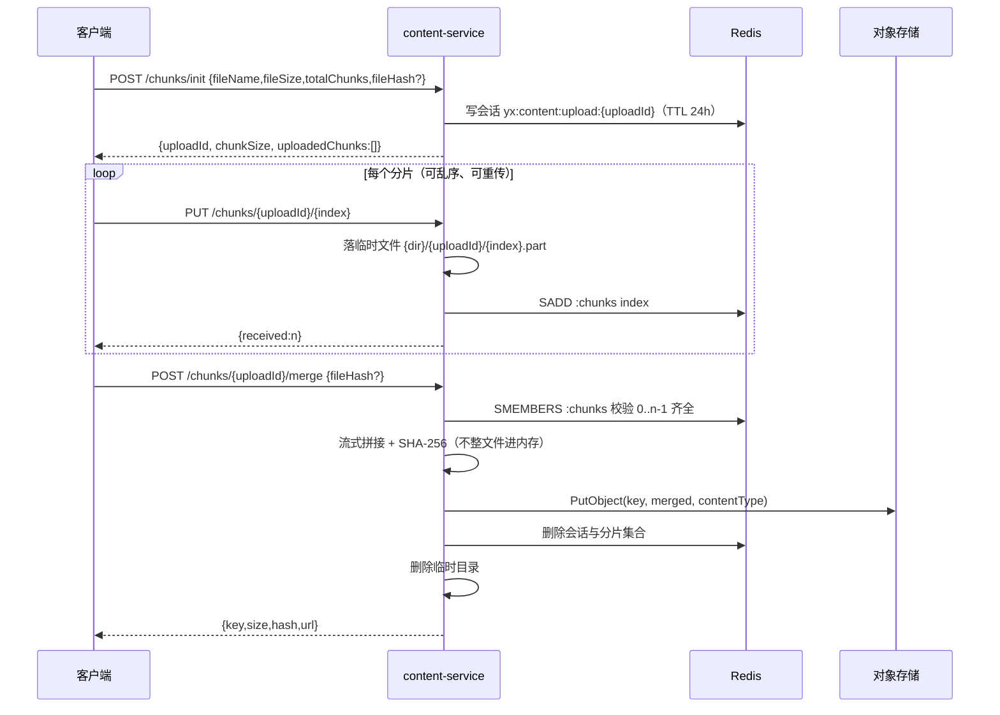

# 文件存储与分片上传方案

> **交付范围**：10 月 20 日任务第 2 项——大文件存取、对接云 OSS、文件分片上传与后台重组、下载开源文件服务器并阅读源码、小文件批量读写。
> **代码位置**：`backend/common-file`（存储抽象与三种实现）+ `backend/services/content-service/file`（上传/分片/下载接口）。
> **实测环境**：2026-10-27 与 2026-10-31，JDK 17 / Spring Boot 3.5.16；对象存储主选 **SeaweedFS 4.51**（S3 兼容），rclone 1.75.2 `serve s3` 作为离线保底；MySQL 3307、Redis 6380（避开禅道占用的 3306/6379）。

## 1 交付结论与验收证据

| 能力 | 实现 | 实测证据 |
|---|---|---|
| 小文件批量上传 | `POST /api/content/files`（multipart 多文件） | 10 个文件一次请求 **113.1 ms**，返回 10 条 `{key,hash,url}` |
| 大文件分片上传 | `POST /chunks/init` + `PUT /chunks/{id}/{index}` | 20 MB 文件切 4 片（5 MB/片）逐片上传成功，`received` 依次 1→4 |
| 后台重组 | `POST /chunks/{id}/merge` 流式拼接 + 边合并边算 SHA-256 | 合并后 **SHA-256 与原文件一致**（`91921e33…0a8da`） |
| 完整性校验 | 合并结果与声明的 `fileHash` 比对 | 传错 hash 返回 **2708**；分片缺失返回 **2704** |
| 秒传/去重 | key = 日期 + SHA-256，同内容同 key | 同 hash 再次 init 返回 `instant=true`，未产生新对象 |
| 下载 | 预签名临时地址 + 服务端流式下载 | 两条路径下载的 SHA-256 均与原文件一致 |
| 批量读取 | `POST /batch-urls`（一次 ≤50 个） | 返回预签名地址，有效期 1800 s |
| 清理 | 合并/取消删除临时分片与 Redis 会话 | 合并后 Redis 会话 0 条、临时目录 0 个 |
| 云 OSS | `OssFileStorage`（阿里云 OSS SDK） | 适配器单测通过（Mock 客户端，无需真实 AK/SK） |

对象落盘证据：`D:/Temp/rclone/data/yingxin/2026/10/27/91/91921e33…0a8da.pdf`，大小 **20,971,520 字节**，与上传文件一致。

2026-10-31 又用 **SeaweedFS 4.51** 复跑同一套接口：20 MB / 4 片合并后 SHA-256 一致（`2b4e8ab9…e20d`），
预签名下载、`Range` 读取、服务端下载全部通过，**代码零改动**（只换 `MINIO_ENDPOINT` 与凭证）。

## 2 选型：SeaweedFS 为主，rclone 保底

### 2.1 结论：选 SeaweedFS 4.51

2026-10-27 拉取时确认：MinIO 官方已归档开源的 Server / Client / KES 项目，
`https://dl.min.io/server/minio/release/windows-amd64/minio.exe` 与
`.../linux-amd64/minio` 均返回 **410 Gone**，页面原文说明“不再分发任何社区版与热修复构建”；
`docker.io/minio/minio:latest` 在本机网络下也无法拉取。**MinIO 不作为本轮选型。**

**主选：SeaweedFS 4.51**，理由：

1. **活跃、开源**：Apache-2.0，2026 年仍在发版；Windows 有单文件 `weed.exe`，也有 Docker 镜像；
2. **S3 兼容**：`minio-java` SDK 直接对接，现有 `MinioFileStorage` **一行代码不改**；
3. **自带界面**：Filer Web UI（`http://localhost:8888`）可直接看目录/对象，满足期中“界面演示”；
4. **架构可讲**：master / volume / filer / S3 四件套，对象以 needle 存在 volume 的 `.dat/.idx` 里，
   比“单机目录 + S3 网关”更适合讲“文件存取逻辑”；
5. **实测通过**：20 MB/4 片合并、预签名 URL、Range 读取、服务端下载全部成功。

**保底：rclone 1.75.2 `serve s3`**：单二进制、下载快、源码已读（§3），适合网络受限时离线演示；
它与 SeaweedFS 走同一套 S3 协议，切换只改 endpoint/凭证。

**不选**：FastDFS（非 S3，要新写适配器）、Ceph RGW（对课程环境太重）、MinIO（社区版已归档）。
**云端**仍用阿里云 OSS：切 `FILE_PROVIDER=oss` 与环境变量即可，业务代码零改动。

> 报告口径：不是“没做 MinIO”，而是“MinIO 社区版停止分发，改用同协议、活跃维护的 SeaweedFS 完成验收，
> rclone 作为离线保底；三者都是 S3 协议，业务代码不变”。

### 2.2 三套实现的分工

| 实现 | 场景 | 依赖 | 预签名 |
|---|---|---|---|
| `LocalFileStorage` | 单测、离线开发 | 本地磁盘 | 不支持（回退服务端下载接口） |
| `MinioFileStorage` | 自建 S3：**SeaweedFS（主选）**、rclone（保底）、MinIO、Ceph RGW | minio-java 8.5.17 | 支持 |
| `OssFileStorage` | 云端正式环境 | aliyun-sdk-oss 3.17.4 | 支持 |

三者由 `yx.file.provider=local|minio|oss` 通过 `@ConditionalOnProperty` 互斥装配，业务只依赖 `FileStorage` 接口。

## 3 开源文件服务器源码阅读笔记

阅读对象：**rclone v1.75.2 的 `cmd/serve/s3`**（Go，约 1.2 万行含测试）。以下行号对应 tag `v1.75.2`。

### 3.1 代码结构

| 文件 | 职责 | 关键函数 |
|---|---|---|
| `server.go` | HTTP 服务、鉴权、路由 | `auth`（182）、`Bind`（210）、`proxyAuthMiddleware`（240） |
| `backend.go` | S3 后端语义 → rclone VFS | `PutObject`（442）、`HeadObject`（275）、`GetObject`（332）、`CreateBucket`（592）、`DeleteObject`（560） |
| `multipart.go` | S3 原生 Multipart Upload | `CreateMultipartUpload`（268）、`UploadPart`（332）、`streamDirect`（580）、`bufferPart`（739） |
| `s3.go` / `list.go` | 请求/响应类型与列举 | — |
| 外部依赖 | S3 协议解析 | `github.com/rclone/gofakes3` |

### 3.2 一次请求的链路

```
HTTP 请求
  → chi router（server.go Bind，211 行把 /* 交给 handler）
  → gofakes3 解析 S3 协议（路径风格 bucket/key、SigV4、XML 响应）
  → s3Backend（backend.go）把 S3 语义翻译成 VFS 操作
  → VFS 缓存层（server.go getVFS，131）
  → 本地/远端 backend（本项目是 :local: 目录）
```

鉴权在 `server.go:182`：从请求解析 AccessKeyID，取 secret 后调用
`signature.V4SignVerifyWithSecret(r, secret)` 校验 SigV4；签名不匹配时才重新取密钥重试一次。

### 3.3 桶与对象在文件系统上的样子

`backend.go:592` 的 `CreateBucket` 直接映射成 **建目录**：

```go
_, err = _vfs.Stat(name)
if err == nil {
    return gofakes3.ErrBucketAlreadyExists
}
if err := _vfs.Mkdir(name, 0755); err != nil { ... }
```

这解释了我们实测到的两个现象：

1. **`HEAD /{bucket}` 对不存在的桶也可能返回 200**（VFS 的 Stat 语义与 S3 不完全一致），
   所以 `bucketExists()` 不能作为"桶已存在"的可靠依据；
2. 修正后 `MinioFileStorage.ensureBucket()` 改为**直接 CreateBucket 并忽略 `BucketAlreadyExists`**，
   对 MinIO / rclone / Ceph RGW 都成立。

### 3.4 S3 原生 Multipart 与"应用层分片"的区别

`multipart.go` 实现的是 **S3 Multipart Upload**：`CreateMultipartUpload` 拿 uploadId →
`UploadPart` 按 partNumber 上传 → `CompleteMultipartUpload` 由服务端拼装。要点：

- 每个 part 有独立的 MD5/ETag，`UploadPart` 里用 `newLimitedBody` 限制读取长度（342 行），
  并用 `waitForTurn`（518）控制并发 part 的顺序，`bufferBudget`（97）限制内存占用；
- 合并由**存储服务端**完成，客户端不需要把整个文件读进内存。

本项目的分片是**应用层分片 + 后端重组**，原因是：

1. 课程任务明确要求"后台重组"，需要在自己的代码里体现合并过程；
2. 合并时必须**边写边算 SHA-256** 做完整性校验与去重，S3 Multipart 的 part ETag 不提供整文件哈希；
3. 同一套接口要同时适配不支持原生 Multipart 的本地实现。

代价是合并阶段多一次磁盘读写，20 MB 实测无感；更大文件（>500 MB）应改用存储原生的 Multipart。

### 3.5 小文件批量读写的观察

- rclone 每次 `PutObject` 走一次完整 HTTP + VFS 打开/写入/重命名（日志里可见 `.rclone_temp_put_*` 临时文件再 server-side move），
  所以**批量上传应复用连接、一次请求带多个文件**，而不是 N 次独立请求；
- 我们的 `POST /api/content/files` 用 multipart 一次收 10 个文件，实测 113 ms；
- 批量读取用 `POST /batch-urls` 一次签 50 个地址，避免 50 次签名往返。

### 3.6 SeaweedFS 4.51 源码速读（主选服务端）

SeaweedFS 是 Go 写的分布式文件系统，S3 只是它的一个网关。按请求链路读四个目录即可：

| 位置 | 作用 | 关键点 |
|---|---|---|
| `weed/command/server.go` | `weed server` 子命令 | 一次拉起 master / volume / filer / S3 四个组件，对应端口 9333 / 8080 / 8888 / 9000 |
| `weed/s3api/s3api_server.go` | S3 API 服务 | `NewS3ApiServer`（155 行）注册路由；`auth_signature_v4.go` 做 SigV4 校验 |
| `weed/s3api/s3api_object_handlers.go` | 对象读写 | `GetObjectHandler`（850）、`HeadObjectHandler`（2564）；Range 在这里解析 |
| `weed/s3api/filer_multipart.go` | S3 Multipart | `createMultipartUpload`（67）、`completeMultipartUpload`（657）、`abortMultipartUpload`（1138） |
| `weed/storage/needle/needle.go` | 对象在磁盘上的形态 | `type Needle`（26）＝对象头 + 数据；`CreateNeedleFromRequest`（53）把 HTTP body 变成 needle |
| `weed/storage/volume/` | 卷文件 | 每个卷一对 `.dat`（needle 数据）+ `.idx`（needle 索引），追加写、按 offset 读 |
| `weed/filer/` | 元数据 | bucket/key → fid 的映射；S3 的“对象”最终落到某个 volume 的 needle |

**请求链路**：

```
S3 请求
  → weed/s3api（SigV4 校验、Range/分片解析）
  → filer（bucket + key → fid，元数据）
  → volume server（按 fid 定位 .dat 的 offset，读/写 needle）
```

**和 rclone 的区别**：rclone `serve s3` 是“S3 协议网关 + 本地/远端 VFS”，对象最后还是普通文件；
SeaweedFS 自己管理 volume、needle 与副本，是真正的分布式文件系统。课程里讲“文件存取逻辑”时，
SeaweedFS 的 needle/volume 比 rclone 的“VFS 临时文件 + rename”更有内容。

> 本机实测：`weed server -dir=... -s3 -s3.port=9000 -s3.config=s3.json -master.port=9333 -volume.port=9334 -filer -filer.port=8888`，
> 现有 `MinioFileStorage` 直接上传/下载/预签名/Range 全部通过。

## 4 本项目设计

### 4.1 模块结构

```
backend/common-file/
  storage/FileStorage.java            统一接口：put/get/exists/delete/presign/provider
  storage/LocalFileStorage.java       本地磁盘（防目录穿越）
  storage/MinioFileStorage.java       S3 兼容（MinIO / rclone / Ceph RGW）
  storage/OssFileStorage.java         阿里云 OSS
  config/FileStorageProperties.java   yx.file.provider + 三段子配置
  config/FileStorageAutoConfiguration.java

backend/services/content-service/file/
  FileController.java                 8 个接口
  FileStorageService.java             上传/分片/合并/下载/删除/批量地址
  FileKeyGenerator.java               key 规则、扩展名白名单、SHA-256
  ChunkSession / ChunkSessionStore    分片会话（Redis 实现 + 内存实现）
  FileUploadProperties.java           yx.file.upload.*
  ContentErrorCodes.java              2701–2708
```

### 4.2 对象 key 与去重

```
yyyy/MM/dd/<sha256 前 2 位>/<sha256>.<ext>
例：2026/10/27/91/91921e33…0a8da.pdf
```

- 客户端文件名只用于取扩展名，**不参与路径**（`FileKeyGenerator.sanitizeFileName` 会剥掉 `../` 与 Windows 盘符）；
- 同内容 → 同 key → 天然去重；写入前先 `exists`，存在就跳过（秒传）；
- 下载/删除前用正则校验 key 形态，防止拿任意 key 操作对象存储。

### 4.3 分片上传时序



断点续传：`init` 返回 `uploadedChunks`（同一文件重复 init 时客户端可据此跳过已传分片）；
重传同一分片直接覆盖 `{index}.part`，天然幂等。

### 4.4 Redis 键

| key | 值 | TTL |
|---|---|---|
| `yx:content:upload:{uploadId}` | 会话 JSON（文件名、大小、分片大小、总数、声明 hash） | 24 h |
| `yx:content:upload:{uploadId}:chunks` | Set，已收到的分片序号 | 24 h |

key 统一由 `CacheKeys` 生成，不硬编码；Redis 不可用返回 9003，不会用"半套状态"继续合并。

### 4.5 安全与限制

| 项 | 做法 |
|---|---|
| 类型白名单 | `jpg/jpeg/png/gif/pdf/doc/docx/xls/xlsx/ppt/pptx/zip/txt`，扩展名不在列表返回 2701 |
| 大小 | `spring.servlet.multipart.max-file-size=10MB`（与需求一致）；基础设施上限 `FILE_MAX_SIZE=100MB`；单分片 ≤5MB |
| 文件名 | 服务端生成 key；只保留 basename，防目录穿越 |
| 下载 | 优先预签名临时地址（默认 30 min）；服务端下载不暴露物理路径，`Content-Disposition` 带文件名 |
| 校验 | 合并时边写边算 SHA-256；客户端声明 hash 不一致直接 2708 并清理 |
| 鉴权 | 接口挂在 `/api/content/**`，沿用网关统一鉴权；直连端口调试时无用户上下文（`create_by=0`） |

### 4.6 错误码（2701–2799，已在《开发规范》§3.3 登记）

| 码 | 含义 |
|---|---|
| 2701 | 文件类型不允许（缺扩展名或不在白名单） |
| 2702 | 文件为空或超过大小限制（含分片超限） |
| 2703 | 上传会话不存在或已过期 |
| 2704 | 分片缺失/不完整，或合并大小与声明不符 |
| 2705 | 对象存储暂不可用 |
| 2706 | 文件不存在 |
| 2707 | 一次批量上传文件数超限 |
| 2708 | SHA-256 与声明值不一致 |

## 5 接口一览

| 方法 | 路径 | 说明 |
|---|---|---|
| POST | `/api/content/files` | 小文件批量上传（form-data 字段 `files`） |
| POST | `/api/content/files/chunks/init` | 初始化分片上传（可秒传） |
| PUT | `/api/content/files/chunks/{uploadId}/{index}` | 上传单个分片（字段 `chunk`） |
| POST | `/api/content/files/chunks/{uploadId}/merge` | 合并并写入对象存储 |
| DELETE | `/api/content/files/chunks/{uploadId}` | 取消上传，清理临时分片与会话 |
| GET | `/api/content/files/{key}?name=` | 流式下载（二进制，不套 Result） |
| DELETE | `/api/content/files?key=` | 删除对象 |
| POST | `/api/content/files/batch-urls` | 批量获取临时地址（≤50） |

curl 示例（本机实测命令）：

```bash
# 小文件批量
curl -X POST http://localhost:8106/api/content/files -F files=@a.txt -F files=@b.txt

# 分片
HASH=$(sha256sum big.pdf | cut -d' ' -f1)
curl -X POST http://localhost:8106/api/content/files/chunks/init \
  -H 'Content-Type: application/json' \
  -d "{\"fileName\":\"big.pdf\",\"fileSize\":20971520,\"totalChunks\":4,\"chunkSize\":5242880,\"fileHash\":\"$HASH\"}"
curl -X PUT http://localhost:8106/api/content/files/chunks/<uploadId>/0 -F chunk=@part.aa
curl -X POST http://localhost:8106/api/content/files/chunks/<uploadId>/merge \
  -H 'Content-Type: application/json' -d "{\"fileHash\":\"$HASH\"}"
```

## 6 配置

```yaml
yx:
  file:
    provider: ${FILE_PROVIDER:local}      # local / minio（S3 兼容）/ oss
    local:
      root: ${FILE_LOCAL_ROOT:./data/files}
    minio:                                 # 名字保留 MinIO 生态含义，实际任意 S3 兼容端点
      endpoint: ${MINIO_ENDPOINT:http://localhost:9000}
      bucket: ${MINIO_BUCKET:yingxin}
      access-key: ${MINIO_ACCESS_KEY:minioadmin}
      secret-key: ${MINIO_SECRET_KEY:minioadmin}
    oss:
      endpoint: ${OSS_ENDPOINT:}
      bucket: ${OSS_BUCKET:}
      access-key-id: ${OSS_ACCESS_KEY_ID:}
      access-key-secret: ${OSS_ACCESS_KEY_SECRET:}
    upload:
      dir: ${FILE_CHUNK_DIR:${user.home}/.yingxin/chunks}
      chunk-size: ${FILE_CHUNK_SIZE:5242880}
      max-file-size: ${FILE_MAX_SIZE:104857600}
      ttl-hours: ${FILE_UPLOAD_TTL_HOURS:24}
      max-batch-count: ${FILE_MAX_BATCH_COUNT:10}
      presign-ttl-minutes: ${FILE_PRESIGN_TTL_MINUTES:30}
```

本地起对象存储：主选 **SeaweedFS**（Windows 单文件 `weed.exe`，见 §8），保底 `cd backend && docker compose up -d s3`
（rclone 镜像，端口 9000），两者对应用都是 `MINIO_ENDPOINT=http://127.0.0.1:9000`。
然后以 `FILE_PROVIDER=minio` 启动 content-service。

## 7 边界与后续

- **不新增文件元数据表**：`content_file` 已按 DR-31 裁剪；业务表用 `materials`/`images` JSON 里的
  `{name,url,hash}` 记录文件（数据建模 §8.2）。上传会话只在 Redis，过期即清。
- **未做 S3 原生 Multipart**：当前是应用层重组，>500 MB 再切换。
- **未做**：病毒扫描、图片压缩/水印、Range 断点下载、前端上传页面（Element Plus 的 `el-upload` 可用，但业务页面未实现）。
- **OSS 只做了适配器与单测**：无云端 AK/SK，真机联调列为可选步骤；切换只需环境变量。

## 8 复现步骤

```bash
# 1) 主选：SeaweedFS 4.51（Windows 单文件 weed.exe）
#    下载：https://github.com/seaweedfs/seaweedfs/releases/download/4.51/windows_amd64.zip
mkdir -p D:/Temp/seaweedfs/config D:/Temp/seaweedfs/data
cat > D:/Temp/seaweedfs/config/s3.json <<'EOF'
{
  "identities": [
    {
      "name": "yingxin",
      "credentials": [{ "accessKey": "minioadmin", "secretKey": "minioadmin" }],
      "actions": ["Admin", "Read", "Write", "List", "Tagging"]
    }
  ]
}
EOF
# master 9333 / volume 9334 / filer 8888 / s3 9000
D:/Temp/seaweedfs/weed.exe server -dir=D:/Temp/seaweedfs/data -s3 -s3.port=9000 \
  -s3.config=D:/Temp/seaweedfs/config/s3.json \
  -master.port=9333 -volume.port=9334 -filer -filer.port=8888 -ip=127.0.0.1

# 2) 保底：rclone serve s3（单二进制，无需 Docker）
#    https://downloads.rclone.org/rclone-current-windows-amd64.zip
rclone serve s3 :local:D:/Temp/rclone/data --addr 127.0.0.1:9000 --auth-key minioadmin,minioadmin

# 3) 起 content-service（minio = 任意 S3 兼容：SeaweedFS / rclone / MinIO / Ceph RGW）
cd backend
FILE_PROVIDER=minio MINIO_ENDPOINT=http://127.0.0.1:9000 \
MINIO_ACCESS_KEY=minioadmin MINIO_SECRET_KEY=minioadmin \
MYSQL_PORT=3307 REDIS_PORT=6380 \
./mvnw -pl services/content-service spring-boot:run

# 4) 复跑第 5 节 curl；SeaweedFS 的对象可在 Filer UI 看：
#    http://localhost:8888/buckets/yingxin/
```
