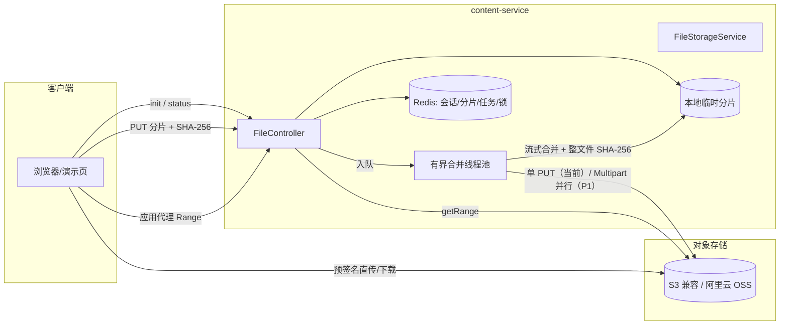

# 项目日程与期中演示规划

> **编制日期**：2026-10-31（周六）
> **硬截止**：2026-11-01（周日）20:00 提交期中录屏（命名：班级+组号），同刻还有软件工程伦理论文、微信小程序实验二、软件体系结构实验二；22:00 提交 Java 4/5/6。
> **本文用途**：① 统计 9/22、10/20 两批任务的完成情况；② 给出 10/20 任务到期中演示的收敛规划；③ 重点回答「如何支持高并发文件上传」，并给出可直接照做的代码改动与压测方案。

---

## 0 一页速览

- **历史任务**：9/22 的 8 项数据库底层任务 **全部完成**；10/20 的原 4 项任务 **全部完成**（禅道分析、文件能力、S5 持久化、OpenAPI）。
- **期中新增的 5 个问题**里，目前只有「大文件分片+后台重组」「小文件批量上传」有可演示的基础实现；**坏块定向重传、下载断点续传、进度条、高并发下载/上传**都还缺关键代码。
- **今天的策略**：先补 4 个能直接对应评分点的 P0（每片校验+定向重传、Range 下载、批量并行、演示页面+进度），再补异步合并与直传对象存储作为「高并发」的讲解与加分项。
- **高并发上传的核心答案**：**应用层分片 + 每片校验 + 异步合并 + 直传对象存储（S3 Multipart 预签名）**；应用服务器只做鉴权、签名、状态与编排，字节流不经过应用服务器。
- **最小可交付**：即使异步合并/直传没写完，也能用现有同步合并 + 新增的分片校验/Range/演示页完成 10 分钟录屏，并在讲解里给出高并发架构图与压测数据。

---

## 1 关键截止时间（按紧迫度）

| 时间 | 事项 | 交付/动作 | 备注 |
|---|---|---|---|
| **10/31 22:00** | 大三下选课 | 完成选课 | 今天，最硬，先留出时间 |
| **11/01 20:00** | 软件工程期中录屏 | ≤10 分钟视频，命名「班级+组号」 | 小组集体，**不可延期** |
| 11/01 20:00 | 软件工程伦理期末论文 | 论文 | 与录屏同刻 |
| 11/01 20:00 | 微信小程序实验二 | 实验报告/代码 | 与录屏同刻 |
| 11/01 20:00 | 软件体系结构实验二 | 实验报告 | 与录屏同刻 |
| **11/01 22:00** | Java 4/5/6 | 作业 | 留 2 小时 |

> **取舍原则**：录屏需要组员配合、且有明确评分点，优先；论文/实验二压到「可交的最小版本」；Java 留 20:00–22:00 两小时。不要把三个作业都拖到周日晚上。

---

## 2 历史任务完成情况统计

### 2.1 9/22 数据库底层任务（8 项，全部完成）

| # | 任务 | 状态 | 交付物/证据 |
|---:|---|---|---|
| 1 | 查询 MySQL 执行计划 | ✅ | [MySQL存储引擎与执行计划.md](MySQL存储引擎与执行计划.md) §5，9 个真实 EXPLAIN（含 `EXPLAIN ANALYZE`） |
| 2 | MySQL 存储结构 | ✅ | 同上 §2：四层结构、页/区/表空间、`.ibd`/redo/undo/binlog、行格式 |
| 3 | 存储引擎分两类怎么配置；引擎参数配置 | ✅ | 同上 §3–§4：InnoDB/MyISAM 对比、四个配置入口、本地/云端参数基线 |
| 4 | 查询计划可视化 | ✅ | `scripts/explain_plan.py` + `docs/assets/explain/` 6 份 JSON/Mermaid |
| 5 | 数据项、数据模型、建模工具 | ✅ | [数据建模.md](数据建模.md)、`数据建模.dbml`、dbdiagram 出图、`docs/assets/er/*.png` |
| 6 | 数据规划架构 | ✅ | 同上 §1 + [MySQL存储引擎与执行计划.md](MySQL存储引擎与执行计划.md) §7（实例/连接/容量/备份） |
| 7 | 数据表建出来 | ✅ | `backend/db/migration/` 9 个脚本、**24 张表、0 外键**，干净容器实测通过 |
| 8 | 表对应存储结构规划 | ✅ | [数据表存储结构规划.md](数据表存储结构规划.md)：逐表引擎/行格式/索引/页数/容量/归档 |

### 2.2 10/20 任务（原 4 项，全部完成）

| # | 任务 | 状态 | 交付物/证据 |
|---:|---|---|---|
| 1 | 禅道建角色、分析角色权限表设置逻辑与存储内容 | ✅ | [禅道角色权限与表结构分析.md](禅道角色权限与表结构分析.md)；自建「迎新项目-只读角色」28 个权限点 + `yx_test`，CLI 实测允许/拒绝（E2006） |
| 2 | 大文件存取、云 OSS、分片上传后台重组、开源文件服务器源码阅读、小文件批量读写 | ✅ 基础版 | [文件存储与分片上传方案.md](文件存储与分片上传方案.md)；`common-file` + 8 个文件接口；20 MB/4 片合并 SHA-256 一致；10 文件批量 113 ms |
| 3 | 物理建表 + 数据持久化代码 | ✅ | qa-service S5：`QaSession` Entity/Mapper/Service/Controller + Redis + 5 个单测；24 表已建 |
| 4 | 接口自动生成文档 | ✅ | 8 个服务补 `@Tag/@Operation`；`scripts/export_openapi.py`；[8 份 openapi.json](api/openapi) + [接口文档索引.md](api/接口文档索引.md) |

### 2.3 累计交付物

| 类别 | 数量/内容 |
|---|---|
| 技术文档 | `docs/` 13 份技术文档（不含本日程；数据库、建模、文件、禅道、规范、需求等） |
| 后端模块 | 12 个 = 9 个服务 + `common-core` / `common-web` / `common-file` |
| 数据库 | 24 张表、0 物理外键、全 InnoDB/Dynamic/utf8mb4 |
| 文件接口 | 8 个（批量上传/分片 init/分片 PUT/合并/取消/下载/删除/批量地址） |
| 接口文档 | 8 份 OpenAPI JSON + 索引 |
| 测试 | 38 个单测全绿（`./mvnw test`） |
| 可复跑脚本 | `explain_checks.sql`、`explain_plan.py`、`export_openapi.py`、`split_dbml.py` |

### 2.4 完成度结论

- **9/22：8/8，100%**。
- **10/20 原任务：4/4，100%**。
- **期中要求的 5 个问题：2 个有基础、3 个半/缺**（详见 §3）。这不算“任务没做”，而是期中把“文件上传”从“能传”提高到了“能讲清楚 5 个机制”。

---

## 3 期中要求 vs 现状差距

| 期中问题 | 现状 | 差距 | 优先级 |
|---|---|---|---|
| 1. 大文件如何分片、后台如何重组（特别是坏块如何通知重传） | 5 MB 分片；合并时流式拼接 + 整文件 SHA-256；hash 不一致返回 2708 | **没有每片校验**，坏块只能在合并时发现；发现后整场会话被删除，**不能只重传坏片** | **P0** |
| 2. 小文件如何批量上传 | `POST /files` 一次 multipart 多文件，10 个 113 ms | 后端是 **for 循环串行**，一个慢文件拖住整批；没有“部分成功”结果 | **P0** |
| 3. 上传/下载如何断点续传 | 上传：Redis 记录已收分片，`init` 返回 `uploadedChunks`；分片 PUT 幂等 | 缺 **查询状态接口**；下载接口 **不支持 Range**，断了只能从头下 | **P0** |
| 4. 上传/下载进度条 | 分片 PUT 返回 `received`；合并是同步阻塞 | 缺合并阶段进度；**前端没有上传页面**（期中要求界面演示） | **P0** |
| 5. 如何支持高并发下载 | 已能生成预签名 URL（MinIO/OSS） | 应用代理下载没有 `Content-Length/Range`；无限流、无压测、无 CDN | **P0/P1** |
| 6. 高并发上传（本项重点） | 同步合并、合并后单次 PUT、无背压/锁/限流 | 合并占请求线程；批次串行；无每用户并发限制；无直传对象存储 | **P1（讲解+加分）** |

> **结论**：期中录屏要的 5 个问题，P0 全部覆盖；高并发上传作为第 6 个加分点，至少要有架构图、代码位置与压测数据，最好有 100–500 并发的实测。

---

## 4 10/20 任务规划（到期中）

### 4.1 目标与非目标

**目标（11/1 20:00 前）**
1. 5 个评分点都能在录屏里“点到代码 + 看到界面 + 给出数据”。
2. 高并发上传/下载有明确的架构方案、容量估算与压测结果。
3. 不破坏现有 38 个单测与已有演示链路。

**非目标（期中后做）**
- 病毒扫描、图片压缩/水印、CDN 接入、跨区域复制；
- 文件元数据表（仍按 DR-31 裁剪，URL/hash 存业务 JSON）；
- 完整前端工程化页面（只做一个零构建的演示页）。

### 4.2 P0（今天必须，直接对应评分点）

| # | 改动 | 代码位置 | 验收 |
|---:|---|---|---|
| P0-1 | **每片 SHA-256 校验 + 定向重传** | `FileController.uploadChunk` 增加 `X-Chunk-Sha256`；`FileStorageService.saveChunk` 边写边算，失败删该片并返回 **2709** `{index, expected, actual}` | 篡改第 2 片 → 2709；只重传第 2 片 → 合并成功且整文件 hash 一致 |
| P0-2 | **上传状态查询** | `GET /chunks/{uploadId}` → `{uploaded:[{index,sha256,size}], missing:[...], expiresAt}` | 传 2 片后中断，重新查询能拿到已传/未传列表，继续传剩余 |
| P0-3 | **下载 Range** | `GET /files/{*key}` 支持 `Range`，返回 206 + `Content-Range` + `Accept-Ranges` + `ETag`；`FileStorage` 增加 `getRange(key, offset, length)` | `curl -r 0-1048575` 返回 206；断点续传后文件 hash 一致 |
| P0-4 | **批量并行 + 部分成功** | `uploadBatch` 用有界线程池（4–8）并行；返回 `{success:[], failed:[{fileName,code,message}]}` | 10 个文件并行；混入 1 个 `.exe` 时其余 9 个成功、该文件单独报 2701 |
| P0-5 | **演示页面 + 进度条** | `content-service/src/main/resources/static/upload-demo.html`：多文件选择、分片进度、暂停/继续、坏片重试、下载进度 | 浏览器打开 `http://localhost:8106/upload-demo.html` 可完整演示 |
| P0-6 | **合并锁 + 基础限流** | Redis `SET NX` 合并锁；每用户并发上传槽位；超限返回 2711/429 + `Retry-After` | 并发点两次合并只有一次成功；第 4 个并发上传被拒 |

### 4.3 P1（录屏前尽量，讲高并发用）

| # | 改动 | 价值 |
|---:|---|---|
| P1-1 | 合并异步化：`POST /merge` 返回 `202 {taskId}`，`GET /merge-status` 轮询 `QUEUED/MERGING/STORING/DONE/FAILED` | 释放 Tomcat 线程；进度条有“合并阶段” |
| P1-2 | 有界合并线程池 + 队列深度指标；拒绝时 429 | 高并发背压的核心 |
| P1-3 | S3 Multipart 直传：`init` 返回预签名 `UploadPart` URL，客户端直传，后端只 `CompleteMultipartUpload` | 字节流不经过应用，真正的水平扩展 |
| P1-4 | 下载端：预签名 + 客户端 4 路 Range 并行；应用代理 `ResourceRegion` | 高并发下载 |
| P1-5 | k6 压测脚本与报告（100/300/500 VU） | 录屏里的“数据” |

### 4.4 P2（期中后）

CDN/OSS 传输加速、图片压缩、病毒扫描、监控告警、上传任务审计表、跨机房容灾。

### 4.5 验收清单

- [ ] 20 MB 文件 4 片，篡改 1 片 → 2709 → 只重传该片 → 合并 hash 一致
- [ ] 上传到 2/4 片刷新页面 → 状态接口返回已传 2 片 → 继续完成
- [ ] 下载中断后 `Range` 续传，最终 hash 一致
- [ ] 10 个小文件批量，其中 1 个非法类型：9 成功 + 1 失败明细
- [ ] 演示页有每文件进度、合并阶段进度、下载进度
- [ ] 500 VU 上传压测：错误率 < 0.1%，p95 < 500 ms（LAN）
- [ ] 1000 VU 下载压测：p95 首字节 < 500 ms，无 5xx
- [ ] `./mvnw test` 全绿（新增用例覆盖 2709/Range/并行批量/锁）

---

## 5 高并发文件上传专题（重点）

### 5.1 目标指标

| 指标 | 目标 | 说明 |
|---|---|---|
| 并发上传 | 500 并发连接 | 报到高峰，5000 新生集中上传材料 |
| 单文件 | 10 MB 常规，100 MB 上限 | 与需求文档一致 |
| 分片 | 5 MB/片，可乱序、可重传 | 断点续传与坏块重传的基础 |
| 上传吞吐 | ≥ 100 MB/s（单机 1 Gbps 网卡） | 应用层不成为瓶颈 |
| 合并时延 | 100 MB p95 ≤ 10 s | 异步化后不影响请求线程 |
| 错误率 | < 0.1% | 含重试后 |
| 下载并发 | 1000 并发 | 80% 走预签名直连，20% 走应用代理 |
| 下载首字节 | p95 < 500 ms | Range 命中 |
| 数据完整性 | 0 丢失/0 损坏 | 每片 + 整文件双重校验 |

### 5.2 瓶颈分析

| 环节 | 现状 | 并发下的问题 | 对策 |
|---|---|---|---|
| HTTP 接入 | Tomcat 默认 200 线程，未调优 | 大文件上传长期占用线程 | `max-threads=400`、`accept-count=200`、`max-connections=8192`；上传/下载分离线程池 |
| 批量小文件 | `for` 循环串行 | 一个慢文件拖住整批 | 有界线程池并行（4–8），部分成功 |
| 分片落盘 | `transferTo` 临时文件再 move | 磁盘 IOPS 打满；临时目录与数据盘竞争 | 独立数据盘/NVMe；`file-size-threshold` 调大；分片目录按 uploadId 分片 |
| 校验 | 小文件读两遍（hash + put） | CPU/IO 翻倍 | 单次写边算 digest；分片 SHA-256 与写并行 |
| 合并 | 请求线程内顺序拼接 + 单次 PUT | 100 MB 合并占线程 10 s+；并发合并互相抢 CPU/磁盘 | **异步合并 + 有界队列 + 合并锁**；S3 Multipart 并行上传 |
| 对象存储 | 合并后单次 `PutObject` | 大文件单流慢；失败要整文件重传 | S3 Multipart（8 MB part，4–8 并行，按 part 重试） |
| 状态存储 | 每片一次 Redis `SADD` | 热 key、往返多 | pipeline 批量；会话 key 天然按 uploadId 分散 |
| 下载 | `InputStreamResource` 无长度、无 Range | 不能断点/并行；应用线程被慢客户端占住 | `ResourceRegion` + `Range` + `ETag`；预签名直连；CDN |
| 资源保护 | 无限流/无并发上限 | 单个用户可打满线程/带宽 | 每用户并发槽位、网关令牌桶、429 + Retry-After |

### 5.3 总体架构



两条路径要讲清楚：

- **教学/兼容路径**：客户端 → 应用 → 临时分片 → 后台合并 → 单次 PUT 对象存储。满足“后台重组”的课程要求。
- **高并发路径**：客户端拿预签名 URL → 直传对象存储（Multipart）→ 应用只做 `init/complete/status`。应用不再承载字节流，吞吐由对象存储水平扩展。

### 5.4 关键设计

#### 5.4.1 分片与坏块定向重传

**协议**
- `POST /chunks/init` 返回 `uploadId`、`chunkSize`、`totalChunks`、`uploadedChunks`、`expiresAt`。
- `PUT /chunks/{uploadId}/{index}` 增加请求头 `X-Chunk-Sha256`（64 位十六进制）。
- 服务端用 `DigestInputStream` 包住 `MultipartFile.getInputStream()`，**边写临时文件边算 SHA-256**，零额外读。
- 校验失败：删除该片临时文件、**不写入 Redis 分片集合**，返回 `2709`：
  ```json
  {"code":2709,"message":"分片校验失败，请重传该分片","data":{"index":2,"expected":"...","actual":"..."}}
  ```
- 客户端只重传 `index=2`，最多 3 次指数退避；成功后再继续。
- 合并前从 Redis 读每片 `{sha256,size}`，缺片返回 `2704 {missing:[...]}`；合并后再算整文件 SHA-256，不一致返回 `2708` 并**保留分片**（便于定位/重试），不要像现在这样直接清空会话。

**为什么不用整文件 hash 代替**：整文件 hash 只能告诉“坏了”，不能告诉“哪一片坏”；100 MB 重传全部片代价是 20 倍。

**Redis 结构**
```
yx:content:upload:{uploadId}                 Hash/JSON：fileName,size,chunkSize,totalChunks,contentType,declaredHash,expiresAt
yx:content:upload:{uploadId}:chunks           Set：已验收的分片序号
yx:content:upload:{uploadId}:chunk:{index}    Hash：sha256, size, acceptedAt
```

#### 5.4.2 小文件批量并行

- 接口保持 `POST /files`（multipart 多文件），后端用 `ThreadPoolExecutor(core=4,max=8,queue=100)`。
- 每个文件一个 `CompletableFuture`，单文件失败不影响其他文件；返回：
  ```json
  {"success":[{"fileName":"a.pdf","key":"...","hash":"..."}],
   "failed":[{"fileName":"b.exe","code":2701,"message":"不支持的文件类型：.exe"}]}
  ```
- 单文件处理改为**一遍写、一遍算**：`DigestInputStream` → `storage.put`，不再 `hash` 读一遍、`put` 再读一遍。
- 批内并发度可配（`yx.file.upload.batch-parallelism=4`），避免 10 个大文件同时打满磁盘。

#### 5.4.3 断点续传

**上传**
- 客户端本地保存 `{fileHash, uploadId, fileName, size}`。
- 刷新/重进：`GET /chunks/{uploadId}` 返回 `uploaded`/`missing`；只补 `missing`。
- 分片 PUT 幂等：同 `index` 同 `sha256` 直接 200，不重写；不同则覆盖。
- 会话 TTL 24 h；定时任务清理过期临时目录（`@Scheduled` 每小时扫一次）。

**下载**
- 响应头：`Accept-Ranges: bytes`、`ETag: "<sha256>"`、`Content-Length`。
- 请求 `Range: bytes=1048576-` → `206` + `Content-Range: bytes 1048576-20971519/20971520`。
- 客户端保存已下载字节数，续传时带 `Range` + `If-Range: <ETag>`；ETag 不变才续，变了从头下。
- 预签名 URL 天然支持 Range（S3/OSS/MinIO 都支持），高并发下载优先走这条。

#### 5.4.4 进度条

| 阶段 | 数据来源 | 前端展示 |
|---|---|---|
| 分片上传 | 每个 PUT 返回 `{received,total,bytesReceived}` | 每文件进度条 = 已传字节/总字节；并发分片时按字节累加 |
| 合并 | `GET /chunks/{id}/merge-status` → `{state,percent}` | 合并阶段单独一条“处理中 60%” |
| 下载 | `Content-Length` + XHR `onprogress`（或 Range 分段） | 下载进度条；预签名直连时用 Range 分段自己算 |
| 批量 | 每个文件的进度 + 总进度 | 列表 + 总进度条 |

合并状态放 Redis：`yx:content:merge:{uploadId}` Hash（state/percent/startedAt/error），TTL 1 h；阶段更新点：入队 0%、开始合并 10%、拼接完成 70%、上传存储 80%、完成 100%。

#### 5.4.5 异步合并与背压

- `POST /merge` 不再同步执行：提交到 `mergeExecutor`，立即返回 `202 {taskId}`；客户端轮询状态。
- 线程池：`core=4, max=8, queue=200`；拒绝策略 `AbortPolicy` → 返回 **2711**（或 429）+ `Retry-After: 1`。
- 合并锁：`SET yx:content:merge:lock:{uploadId} 1 NX EX 300`；拿不到说明正在合并，返回 **2710**“正在合并，请勿重复提交”。
- 每用户并发上传槽位：`INCR yx:content:user:{uid}:uploads`，超过 3 返回 2711；`finally` 里 `DECR`，key 设 TTL 防泄漏。
- 队列深度、合并耗时、拒绝次数打点到日志/Actuator；压测时观察是否成为新瓶颈。

#### 5.4.6 直传对象存储（高并发的关键）

应用层重组适合教学与本地实现，但**高并发时应用服务器是瓶颈**：500 个 100 MB 合并会让 CPU/磁盘/网卡全部打满。规模方案：

1. `POST /files/multipart/init`：服务端 `CreateMultipartUpload`，按 8 MB 生成 N 个**预签名 UploadPart URL**，返回 `{uploadId,key,parts:[{partNumber,url}]}`。
2. 客户端并行 PUT 到对象存储（4–8 并发），每个 part 独立重试；应用不接触字节流。
3. `POST /files/multipart/complete`：客户端提交 `[{partNumber,etag}]`，服务端 `CompleteMultipartUpload`，再 `HeadObject` 校验大小/ETag。
4. 失败 `AbortMultipartUpload`；未完成的 multipart 由对象存储生命周期规则清理。

**对比**

| 维度 | 应用层重组（当前） | S3 Multipart 直传（P1） |
|---|---|---|
| 字节流经过应用 | 是 | 否 |
| 应用 CPU/带宽 | 合并 + PUT 占满 | 仅签名/状态，几乎为 0 |
| 扩展方式 | 加应用实例，仍受网卡限制 | 对象存储水平扩展 |
| 坏块重传 | 应用判定 + 客户端重传 | 对象存储返回 part 错误，客户端只重传该 part |
| 课程演示 | ✅ 能讲“后台重组” | ✅ 能讲“高并发扩展” |

**建议**：录屏里先演示应用层重组（满足题目），再用 1 页架构图讲直传（回答“高并发”），两者不冲突。

#### 5.4.7 高并发下载

- **80% 流量走预签名直连**：`POST /batch-urls` 一次签 50 个；客户端 4 路 Range 并行；对象存储承担带宽。
- **20% 走应用代理**（需要属主校验/审计时）：
  - `ResourceRegion` + `HttpRange`，`Content-Length` 必须设置；
  - 64 KB 缓冲流式输出，禁止 `byte[]` 全量读；
  - `ETag`/`Last-Modified` 支持条件请求；
  - Tomcat 下载线程池与上传隔离，避免大文件下载拖垮上传。
- **限流**：网关 `RequestRateLimiter`（Redis 令牌桶），每用户 20 req/s、burst 50；应用侧再加每 IP 100 req/s 兜底；超限 429 + `Retry-After`。
- **前置**：云端 OSS + CDN；本地 SeaweedFS/rclone 前面挂 Nginx（`sendfile on`、`proxy_buffering off`）。
- **并行 Range**：客户端把文件切成 4 段，各自 `Range` 下载，最后按序合并；断点续传只需重下失败段。

#### 5.4.8 容量与资源估算

以 5,000 新生、每人 3 个文件、平均 2 MB 计算：

| 项 | 估算 | 说明 |
|---|---|---|
| 总容量 | 30 GB/批次 | 对象存储，按年归档 |
| 峰值在途 | 500 并发 × 5 MB = 2.5 GB | 分片在临时盘 |
| 网络 | 1 Gbps ≈ 125 MB/s | 2.5 GB / 125 MB/s ≈ 20 s/波 |
| 请求速率 | 500 片 / 20 s = 25 req/s | Tomcat 200–400 线程足够 |
| SHA-256 | ~500 MB/s/核 | 2.5 GB ≈ 5 核·秒；4 核约 1.25 s/波 |
| 临时盘 | ≥ 100 GB NVMe | 留 3 倍余量；每小时清理过期目录 |
| Redis | 500 SADD/s + 状态读写 | 单实例足够；用 pipeline 降往返 |
| 合并 | 100 MB：读 0.2 s + hash 0.2 s + PUT 8 s（100 Mbps） | 必须异步；8 个合并线程、10 s/个 ≈ 48 个/分钟 |

> 结论：**应用层重组在 500 并发、100 MB 文件下会顶到网卡与磁盘**；10 MB 常规文件 + 异步合并可以撑住；真正的高并发要直传对象存储。

#### 5.4.9 压测方案

脚本：`scripts/loadtest/upload_download.js`（k6）。

```js
// 伪代码：分片上传 + 下载 Range
import http from 'k6/http';
import { check } from 'k6';

export const options = {
  scenarios: {
    chunk_upload: { executor: 'ramping-vus', startVUs: 0, stages: [
      { duration: '30s', target: 100 }, { duration: '60s', target: 500 }, { duration: '30s', target: 0 }] },
    range_download: { executor: 'constant-vus', vus: 300, duration: '60s', startTime: '10s' },
  },
  thresholds: {
    http_req_failed: ['rate<0.001'],
    http_req_duration: ['p(95)<500'],
  },
};

export default function () {
  // 1) init → 2) PUT 5MB 分片（带 X-Chunk-Sha256）→ 3) merge → 4) GET Range
}
```

观测：`http_req_duration`、`http_req_failed`、自定义 `merge_duration`、`upload_bytes`；同时看 CPU、磁盘 IOPS、网卡、Tomcat busy threads、合并队列深度、Redis 延迟。

调优顺序：先看应用线程/队列 → 再看磁盘 → 再看网卡 → 最后才加机器。压测报告记录“拐点”（如 300 VU 后 p95 突增），作为高并发讲解的证据。

### 5.5 代码改动清单

| 文件 | 改动 |
|---|---|
| `content/file/FileController.java` | 新增 `GET /chunks/{id}`、`GET /chunks/{id}/merge-status`；`PUT` 增加 `X-Chunk-Sha256` 参数；下载改为 `ResponseEntity<ResourceRegion>` 并解析 `Range`；合并返回 `202` |
| `content/file/FileStorageService.java` | `saveChunk` 边写边校验；`merge` 异步化 + 锁；`mergeChunks` 保留分片；`uploadBatch` 并行 + 部分成功；新增 `getRange` |
| `content/file/ChunkSessionStore.java` / `RedisChunkSessionStore.java` | 增加每片 `sha256/size` Hash、`missing()`、合并任务状态、锁、用户槽位 |
| `content/file/ChunkSession.java` | 增加 `expiresAt`、`chunkHashes`（或拆到 Redis Hash） |
| `common-file/.../FileStorage.java` | 新增 `getRange(key, offset, length)`；`putMultipart/abortMultipart`（P1） |
| `common-file/.../MinioFileStorage.java` / `OssFileStorage.java` | Range 读取；预签名 UploadPart（P1） |
| `content-service/application.yml` | Tomcat 线程/连接、multipart 阈值、批内并行度、合并池、限流参数 |
| `resources/static/upload-demo.html` | 零构建演示页：选择/拖拽、分片、进度、暂停/继续、坏片重试、下载进度 |
| `scripts/loadtest/upload_download.js` | k6 压测脚本 |
| 测试 | `ChunkChecksumTest`、`RangeDownloadTest`、`BatchParallelTest`、`MergeLockTest`、`MergeStatusTest` |
| 文档 | [文件存储与分片上传方案.md](文件存储与分片上传方案.md) 增加“坏块重传/Range/高并发/压测”章节 |

**新增错误码**（content 段 2701–2799，需同步 [开发规范](开发规范.md) §3.3）：

| 码 | 含义 |
|---|---|
| 2709 | 分片 SHA-256 与声明不一致（带 index） |
| 2710 | 该上传正在合并，请勿重复提交 |
| 2711 | 并发上传数超限，请稍后重试（429 + Retry-After） |
| 2712 | Range 不合法/不可满足（416） |

### 5.6 风险与降级

| 风险 | 影响 | 降级 |
|---|---|---|
| 时间不够，P0 写不完 | 录屏缺演示 | 保底：现有分片 + 合并 + 手写 curl；至少补 Range 与 demo 页 |
| 异步合并引入竞态 | 重复合并/丢片 | 合并锁 + 幂等状态机 + 单测覆盖 |
| 临时盘写满 | 上传失败 | 配额 + 定时清理 + 监控 `FILE_CHUNK_DIR` |
| 限流误伤正常用户 | 429 | 只对写接口限流；白名单/本地关闭；阈值可配 |
| SeaweedFS/rclone 与 MinIO 行为差异 | 分片/预签名异常 | 适配器单测 + 真实 SeaweedFS 联调；云端 OSS 另测 |
| 演示时网络/服务挂了 | 录屏失败 | 提前录制备份片段；演示页本地静态化；数据预置 |

---

## 6 10 分钟录屏脚本

> 录制要求：≤10 分钟、线上录屏、命名「班级+组号」。建议 1080p，字号调大，终端与浏览器各占一半。

| 时间 | 内容 | 画面/操作 | 对应评分点 |
|---|---|---|---|
| 0:00–0:40 | 开场与架构 | 展示模块图：`common-file` + content-service + Redis + 对象存储；一句话讲两条路径（后台重组 / 直传） | 全局 |
| 0:40–3:00 | **大文件分片 + 后台重组 + 坏块重传** | 演示页选 20 MB 文件 → 4 片进度 → 故意改坏第 2 片 → 返回 2709 index=2 → 只重传第 2 片 → 合并成功 → 对比 SHA-256；切到 `saveChunk`/`mergeChunks` 代码讲“边写边算 + 流式拼接” | 问题 1 |
| 3:00–4:20 | **小文件批量** | 一次选 10 个文件 → 并行进度 → 混入 1 个 `.exe` → 9 成功 1 失败明细；讲 `uploadBatch` 线程池与部分成功 | 问题 2 |
| 4:20–6:20 | **断点续传** | 上传到 2/4 片关闭页面 → 重新打开 → 状态接口显示已传 2 片 → 继续完成；下载中断 → `Range` 续传 → hash 一致；讲 `GET /chunks/{id}` 与 `Accept-Ranges` | 问题 3 |
| 6:20–7:20 | **进度条** | 每文件进度 + 合并阶段 `QUEUED→MERGING→STORING→DONE` + 下载进度；讲状态存 Redis | 问题 4 |
| 7:20–9:10 | **高并发下载 + 高并发上传** | 预签名 URL + 4 路 Range 并行下载；k6 500 VU 上传/1000 VU 下载结果截图（p95、错误率、吞吐）；讲“应用层重组 vs 直传对象存储”与容量估算 | 问题 5 + 加分 |
| 9:10–9:50 | 边界与总结 | 未做：病毒扫描、CDN、元数据表；下一步：直传 Multipart + 限流；一句话总结 | 收尾 |

**录制前检查**
- [ ] MySQL/Redis/S3 已起，content-service 8106 可访问，演示页能打开
- [ ] 预置 20 MB 测试文件、10 个小文件、1 个 `.exe`；哈希已记录
- [ ] 压测报告截图/录屏已准备（避免现场跑压测）
- [ ] 终端字号 ≥ 18，浏览器缩放 125%，代码关键行已加注释
- [ ] 录屏软件麦克风测试；每段先录 10 秒废片再正式
- [ ] 备份：关键片段单独录，剪辑时拼接

**提交**
- 文件命名：`班级+组号`（按老师要求，不要加多余后缀）
- 截止：11/1 20:00；建议 18:00 前上传，留 2 小时缓冲
- 同时检查伦理论文、小程序实验二、软件体系结构实验二、Java 456 的提交入口

---

## 7 今日/明日排期

### 7.1 10/31（周六）

| 时间 | 事项 | 产出 |
|---|---|---|
| 08:00–09:30 | 现状盘点 + 本文档 | 本文件 |
| 09:30–12:00 | P0-1/2：分片 SHA-256 + 2709 + 状态接口 | 代码 + 单测 |
| 12:00–13:00 | 午饭/休息 | — |
| 13:00–15:30 | P0-3/4：Range 下载 + 批量并行 | 代码 + curl 验证 |
| 15:30–18:00 | P0-5/6：演示页 + 合并锁/限流 | 可操作的 HTML 页面 |
| 18:00–19:30 | 联调 + k6 初测 | 压测初值 |
| 19:30–21:30 | 录第一版（分段录） | 粗剪素材 |
| **21:30–22:00** | **大三下选课（硬截止）** | 完成选课 |
| 22:00–23:30 | 补录/剪辑 | 接近成片 |

### 7.2 11/1（周日）

| 时间 | 事项 | 产出 |
|---|---|---|
| 08:30–11:00 | 补录 + 伦理论文/实验二（先各写最小可交版） | 三份作业初稿 |
| 11:00–14:00 | 继续作业 + 录屏剪辑 | — |
| 14:00–16:00 | 最终彩排 + 压测数据截图 | 成片候选 |
| 16:00–18:00 | 剪辑/字幕/命名检查 | 成片 |
| 18:00–19:30 | 缓冲：补录、检查提交入口 | — |
| **20:00** | **提交录屏 + 伦理论文 + 小程序实验二 + 软件体系结构实验二** | 硬截止 |
| **20:00–22:00** | **Java 4/5/6** | 硬截止 22:00 |

> 这是理想排期。**如果 10/31 晚上没完成 P0，11/1 上午直接录 MVP**：现有分片/合并 + 新增 Range + 演示页；异步合并/直传用架构图讲，不占用录屏时间。

### 7.3 最小可交付（MVP）fallback

如果只剩 3 小时：

1. **必须**：`Range` 下载（30 分钟）+ 分片 SHA-256/2709（1 小时）+ 演示页（1 小时）+ 录屏（30 分钟）。
2. **可以只讲不写**：异步合并、S3 直传、网关限流——用本文 §5 的图与容量估算讲清楚。
3. **不要**：临时改架构、引入新中间件、现场跑压测。

---

## 8 风险清单

| 风险 | 概率 | 影响 | 应对 |
|---|---|---|---|
| 三份作业与录屏撞车 | 高 | 无法按时交 | 今天先完成录屏素材；作业用最小可交版；周日上午优先录屏 |
| 演示页/接口联调失败 | 中 | 录屏缺界面 | 提前录制备份片段；curl 作为兜底 |
| 端口冲突（禅道占 3306/6379） | 高 | 服务起不来 | 用 3307/6380；README/文档已写 |
| 对象存储镜像/二进制拉不到 | 中 | 文件演示失败 | SeaweedFS 二进制已下载（`weed.exe`）；rclone 保底；再退 `local` provider |
| 限流误伤 | 中 | 演示 429 | 演示环境关闭限流或阈值调大 |
| 压测把机器打满 | 中 | 录屏卡顿 | 压测单独跑并录屏，不现场跑 |
| 成片超 10 分钟 | 中 | 扣分 | 严格按 §6 时间轴，剪辑时砍铺垫 |

---

## 9 附录：常用命令与文件

```bash
# 基础设施（避开禅道端口）
cd backend
# 主选 SeaweedFS（weed.exe，见 docs/文件存储与分片上传方案.md §8）
D:/Temp/seaweedfs/weed.exe server -dir=D:/Temp/seaweedfs/data -s3 -s3.port=9000 -s3.config=D:/Temp/seaweedfs/config/s3.json -master.port=9333 -volume.port=9334 -filer -filer.port=8888 -ip=127.0.0.1
# 保底 rclone serve s3 :local:D:/Temp/rclone/data --addr 127.0.0.1:9000 --auth-key minioadmin,minioadmin

# MySQL/Redis 用 3307/6380（示例，按实际容器名）
# 起 content-service
FILE_PROVIDER=minio MINIO_ENDPOINT=http://127.0.0.1:9000 \
MYSQL_PORT=3307 REDIS_PORT=6380 \
./mvnw -pl services/content-service spring-boot:run

# 演示页
# http://localhost:8106/upload-demo.html

# 测试
./mvnw test

# 接口文档导出
python scripts/export_openapi.py
```

**关键文件**
- 文件能力：[文件存储与分片上传方案.md](文件存储与分片上传方案.md)、`backend/common-file/`、`backend/services/content-service/file/`
- 接口文档：[接口文档索引.md](api/接口文档索引.md)
- 数据库：[数据建模.md](数据建模.md)、[数据表存储结构规划.md](数据表存储结构规划.md)
- 禅道：[禅道角色权限与表结构分析.md](禅道角色权限与表结构分析.md)
- 演示页（待建）：`backend/services/content-service/src/main/resources/static/upload-demo.html`
- 压测脚本（待建）：`scripts/loadtest/upload_download.js`

---

> **一句话总结**：历史任务已经交付完毕；期中不是“重做文件上传”，而是把已有的分片/合并补上“坏块定向重传、断点续传、进度、并发”四件事。高并发的答案是**每片校验 + 异步合并 + 有界队列/限流 + 字节流直传对象存储**，应用服务器只做编排。
