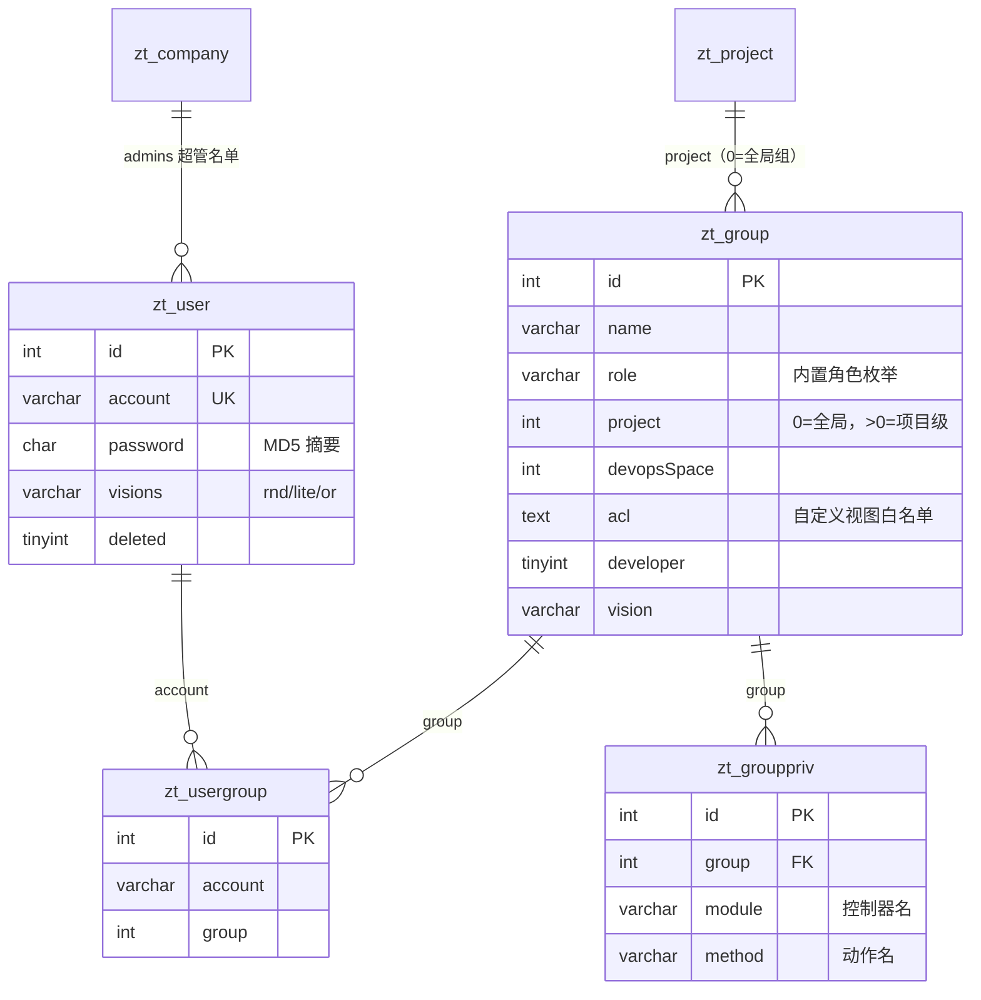

# 禅道角色权限与表结构分析

> **任务来源**：10 月 20 日任务第 1 项——本地安装禅道、自建角色并使用，分析角色权限控制的后台表设置逻辑与表存储内容。
> **分析对象**：本机一键安装包禅道 **22.6**（`D:\Documents\chandao\ZenTao`），MariaDB **10.4.14**，库 `zentao`，表前缀 `zt_`。
> **结论一句话**：禅道的权限模型是「账号 → 角色组 → 权限点（模块.方法）」三层，默认拒绝；项目级角色通过 `zt_group.project` 绑定，超级管理员由 `zt_company.admins` 绕过判定。

## 1 环境与版本

| 项 | 值 | 验证方式 |
|---|---|---|
| 禅道版本 | 22.6 | `zentao version` → `Zentao Server: 22.6` |
| 数据库 | MariaDB 10.4.14，库 `zentao` | `SELECT VERSION()` |
| 安装路径 | `D:\Documents\chandao\ZenTao` | 目录存在，`ZenTao.exe` 运行中 |
| 访问 | `http://localhost/zentao/` | 返回 302 → 登录页 |
| 端口 | 80/443、3306、6379 | 与项目的 Docker 端口冲突，故项目验证环境用 3307/6380 |
| 客户端 | `bin/mysql/bin/mysql.exe` | 只读查询可用；凭据见 `app/zentao/config/mysql.php`，**不写入仓库** |
| CLI | zentao-cli 0.4.0，admin Token 登录 | `zentao profile --effective`；复测时 Basic 认证需临时放行，见 §2.4 |

权限取证的只读 SQL 见 [permission-queries.sql](assets/zentao/permission-queries.sql)，下文所有数字均可在该机复跑。

## 2 实测：建角色并实际使用

### 2.1 建账号（CLI，走真实接口）

```bash
zentao user create --account=yx_test --realname=迎新只读测试 --password=Yx@123456
# {"status":"success","data":{"message":"保存成功","id":2,"status":"success"}}
```

### 2.2 建角色组与权限点

CLI 0.4.0 **没有 group 模块**（`zentao --help` 的模块清单里没有 group/权限组），UI 的建组页也需要 admin 密码，
因此按官方表结构写入三张表（角色组、权限点、用户-组关系）：

```sql
-- 1) 角色组：project=0 表示全局组；role 复用内置枚举 others；vision=rnd 与用户一致
INSERT INTO zt_group (`project`,`devopsSpace`,`name`,`role`,`desc`,`acl`,`developer`,`vision`)
VALUES (0,0,'迎新项目-只读角色','others','课程分析用自定义角色：仅查看项目/任务/需求/文档',NULL,0,'rnd');

-- 2) 权限点：module=控制器，method=动作；共 28 条（只给查看类动作）
INSERT INTO zt_grouppriv (`group`,`module`,`method`) VALUES
(24,'my','index'),(24,'my','todo'),(24,'my','task'),(24,'my','story'),(24,'my','bug'),
(24,'my','project'),(24,'my','dynamic'),(24,'my','profile'),(24,'my','changePassword'),
(24,'project','index'),(24,'project','browse'),(24,'project','view'),
(24,'execution','browse'),(24,'execution','view'),(24,'execution','task'),(24,'execution','story'),
(24,'product','index'),(24,'product','browse'),(24,'product','view'),
(24,'story','browse'),(24,'story','view'),
(24,'task','browse'),(24,'task','view'),
(24,'bug','browse'),(24,'bug','view'),
(24,'doc','index'),(24,'doc','view'),(24,'doc','showFiles');

-- 3) 用户入组
INSERT INTO zt_usergroup (`account`,`group`) VALUES ('yx_test',24);
```

实测结果：`zt_group` 新增 id=24，`zt_grouppriv` 新增 28 行，`zt_usergroup` 新增 1 行。

### 2.3 实际登录验证（CLI 打真实接口）

```bash
zentao login -s http://localhost/zentao -u yx_test -p 'Yx@123456' --no-browser
# 登录成功: yx_test@http://localhost/zentao

zentao project list --limit=3
# {"status":"success","data":[],"pager":{"total":0,...}}    ← 允许（库里暂无项目）

zentao my todos --limit=3
# {"status":"success","data":[],...}                        ← 允许

zentao user create --account=yx_should_fail --realname=不应成功 --password=Yx@123456
# Error(E2006): 当前用户没有权限执行此操作                    ← 拒绝
```

**这是最关键的证据**：同一账号能访问只读接口、不能执行管理动作，说明角色已真实生效，不是只写了库表。

> **关于截图**：登录页在浏览器里可以打开，但自动化点击「登录」按钮时页面没有提交（禅道登录按钮走 JS 校验，
> IAB 的 click 一直等待动作完成直到超时）。为避免继续折腾 UI，本轮以 CLI 输出与数据库行作为证据，未产出截图；
> 若课程明确要求截图，用 `yx_test / Yx@123456` 手动登录补两张即可（我的地盘、访问 `user-create` 的 403 页）。

### 2.4 复测记录（2026-11-02）

隔天重跑一遍，确认结论没漂。**注意前置条件**：一键安装包的 Apache 用 `.ztaccess` 做 Basic 认证，
会先把 CLI 的请求挡成 401（CLI 报 `Error(E1004): 所提供的 Token 已失效`，容易被误判成 token 问题）。
测之前临时把两处认证块换成本地放行，测完立刻还原即可，**不需要重启 Apache**（`.ztaccess` 是每请求读取）：

| 位置 | 作用范围 |
|---|---|
| `app/zentao/www/.ztaccess` | `/zentao/` 整个应用 |
| `app/htdocs/.ztaccess` | 根路径 `/` 与 `index.php` |

```powershell
# 备份 → 把 "# apache auth config" 之后的 5 行换成 Require local → 测 → 还原
Copy-Item app/zentao/www/.ztaccess app/zentao/www/.ztaccess.bak
Copy-Item app/htdocs/.ztaccess        app/htdocs/.ztaccess.bak
# …（改文件、跑测试）…
Copy-Item app/zentao/www/.ztaccess.bak app/zentao/www/.ztaccess -Force
Copy-Item app/htdocs/.ztaccess.bak     app/htdocs/.ztaccess -Force
```

**数据层复测**（`permission-queries.sql` 全量重跑，与首次一致）：

| 指标 | 复测值 | 首次 |
|---|---|---|
| MariaDB 版本 | 10.4.14-MariaDB | 同 |
| 角色组 / 权限点 / 用户组绑定 / 用户 / 模块 / 项目 | 24 / 13257 / 1 / 2 / 219 / 0 | 同 |
| 「迎新项目-只读角色」id=24 权限点数 | 28（8 个模块：bug、doc、execution、my、product、project、story、task） | 同 |
| `zt_usergroup` | `yx_test → group 24` | 同 |
| `zt_company.admins` | `,admin,` | 同 |
| 关键唯一索引 | `zt_grouppriv(group,module,method)`、`zt_usergroup(account,group)` | 同 |

**功能层复测**（用独立 CLI profile 登录 `yx_test`，不覆盖 admin 的配置）：

| 调用 | 期望 | 实际 | 结论 |
|---|---|---|---|
| `zentao login -u yx_test` | 成功 | `登录成功: yx_test@http://127.0.0.1/zentao` | ✅ |
| `project list --limit=3` | 允许 | `{"status":"success","data":[],"pager":{"total":0}}` | ✅ 通过权限闸门 |
| `my todos --limit=3` | 允许 | `{"status":"success","data":[],"pager":{"total":0}}` | ✅ |
| `user create` | 拒绝 | `Error(E2006): 当前用户没有权限执行此操作` | ✅ |
| `product create --name=…` | 拒绝 | `Error(E2006): 当前用户没有权限执行此操作` | ✅ 换一个模块同样被拒 |

两点说明：

- 允许的接口返回 `data:[]` 是**库里真没数据**（`zt_product` / `zt_story` / `zt_task` / `zt_bug` 均为 0 行），不是被权限过滤；
  判定依据是 `status:"success"` 而非 `E2006`。
- 想用 `bug create` 当反例不成立：CLI 会先被参数校验拦下（`E2003 缺少必要参数 openedBuild`），走不到权限判定那一步。
- 复测后已还原认证配置，`/`、`/zentao/`、`/adminer/` 全部回到 401，与复测前一致。

## 3 权限模型



三层关系的要点：

1. **用户与组是多对多**：一个账号可进多个组，权限取**并集**；`zt_usergroup(account, group)` 有唯一索引。
2. **权限点 = 模块.方法**：`module` 是控制器名（`project`、`execution`、`story`…），`method` 是动作名（`browse`、`view`、`create`…）。权限点的全集来自代码 `config/privilege.php`，**不是**来自 `zt_module`——`zt_module` 是产品/项目的业务模块树（本机 219 行），两者容易混淆。
3. **只有允许、没有拒绝**：表里存的是"允许集合"，没查到就是拒绝（默认拒绝）；没有 deny 规则，也没有优先级。
4. **项目级角色**：`zt_group.project = 0` 是全局组；`> 0` 表示绑定到某个项目，只在项目上下文里合并（见 §4.3）。
5. **超级管理员**：`zt_company.admins` 是逗号拼接的账号串（本机 `,admin,`），判定时直接放行，不需要任何 `zt_grouppriv` 行。

## 4 权限判定流程（源码级）

### 4.1 登录时装载权限

`module/user/model.php:1154 authorize($account)`：

```php
SELECT module, method FROM zt_group t1
LEFT JOIN zt_usergroup t2 ON t1.id = t2.`group`
LEFT JOIN zt_grouppriv t3 ON t2.`group` = t3.`group`
WHERE t2.account = :account
  AND t1.project = 0
  AND t1.devopsSpace = 0
  AND t1.vision = :currentVision
```

装载结果放进会话的 `rights`，并强制补上首页权限：

```php
$rights = array('index' => array('index' => 1), 'my' => array('index' => 1));
$rights[strtolower($module)][strtolower($method)] = true;   // 逐行合并
```

**注意 `vision` 条件**：用户 `yx_test` 的 `visions=rnd`，角色组的 `vision` 也必须是 `rnd`，否则权限装载不到。
这是新建角色时最容易踩的坑。

### 4.2 请求时判定

`module/common/model.php:1362 hasPriv($module,$method)` → `getUserPriv`（1398 行起）：

```
Tutorial 模式                    → true
未登录                           → false
groupPrivs 别名映射（browse→view） → 递归判定
对象已关闭（canBeChanged）        → false
超级管理员（company.admins）      → true
openMethods / logonMethods       → true
项目/产品/执行管理员              → true
rights[module][method] 存在       → checkPrivByRights(acls, object)
否则                             → false
```

两个补充点：

- **导航过滤**：页面渲染左侧菜单时也按 `rights` 过滤（`common/model.php:681`），没权限的入口不显示；
- **对象级 ACL**：`rights` 只回答"能不能进这个模块/动作"，具体某条记录能不能看由 `acls` 与 `checkPrivByRights` 再判一次。

### 4.3 项目级权限的合并

`common/model.php:1511` 在项目上下文里再查一次：把 `zt_group.project = 当前项目` 的组权限查出来，按项目的
`auth` 策略 `extend`（与全局权限合并）或 `reset`（覆盖全局权限）。所以同一个账号在 A 项目可以是只读、在 B 项目可以是成员。

### 4.4 角色组权限的维护逻辑

- `group/model.php:282 getPrivs($groupID)`：`SELECT module,method FROM zt_grouppriv WHERE group=?`，按 module 聚成二维数组；
- `group/model.php:514 insertPrivs($privs)`：先查已有三元组做差集，只插不存在的，靠 `UNIQUE(group,module,method)` 保证幂等；
- `group/model.php:610 updatePrivByGroup()`：先删该导航下的旧权限，再 `REPLACE` 一条 `index.index`，最后插入本次勾选项。

也就是说：**UI 上勾选保存 = 先删后插**，权限点表是"当前状态"而不是"变更日志"；审计要看 `zt_action`，不在权限表里。

## 5 表结构与存储内容

### 5.1 核心表

| 表 | 主键/唯一键 | 关键列 | 作用 | 实测行数 |
|---|---|---|---:|---:|
| `zt_user` | `id` PK，`account` UK | `password CHAR(32)`（MD5）、`visions`、`deleted` | 账号 | 2 |
| `zt_group` | `id` PK | `project`、`devopsSpace`、`name`、`role`、`acl`、`developer`、`vision` | 角色组 | 24 |
| `zt_grouppriv` | `id` PK，`UNIQUE(group,module,method)` | `group`、`module`、`method` | 组 → 权限点 | 13,257 |
| `zt_usergroup` | `id` PK，`UNIQUE(account,group)` | `account`、`group` | 用户 → 组 | 1 |
| `zt_company` | `id` PK | `admins`（逗号串） | 超管名单 | 1 |
| `zt_module` | `id` PK | 树形业务模块 | **不是**权限点 | 219 |
| `zt_project` | `id` PK | 项目主表 | 项目级权限的上下文 | 0 |

### 5.2 存储内容规律

- 23 个内置角色组 + 1 个自定义组（id=24）；内置组权限点数量差异很大：管理员 **1,547**、研发 **755**、guest **475**、自定义只读 **28**；
- `zt_grouppriv` 共 13,257 行，`data_length≈1.5 MB`、`index_length≈480 KB`——权限点表很小，读多写少，适合登录时一次性装载；
- 权限点命名与代码控制器/动作一一对应，例如 `project.browse`、`execution.view`、`my.todo`；少数 method 是数字（工作流相关），说明该表也承载流程节点的授权；
- 权限的"字典"在 `config/privilege.php`（模块清单、`openMethods`、`logonMethods`、`groupPrivs` 别名映射），表里只存已授予的三元组；
- 没有 deny 行、没有生效时间、没有优先级——要"临时禁用某人"只能移出组或删权限行。

### 5.3 自定义角色的实际数据

```
zt_group:      24 | 迎新项目-只读角色 | role=others | project=0 | devopsSpace=0 | developer=0 | vision=rnd
zt_grouppriv:  28 行，覆盖 my/project/execution/product/story/task/bug/doc 八个模块的查看类动作
zt_usergroup:  yx_test → 24
zt_user:       yx_test | 迎新只读测试 | visions=rnd | deleted=0
zt_company:    admins = ,admin,
```

### 5.4 物理存储

全部 InnoDB / Dynamic / utf8mb4（与项目库一致）。`zt_grouppriv` 是唯一有实际数据量的表（约 1.5 MB 数据 + 0.5 MB 索引），
`zt_user`、`zt_group`、`zt_usergroup` 都只有几个 16 KB 页。唯一索引 `(group,module,method)` 既是幂等保障，也是
"按组取权限"的覆盖索引（`getPrivs` 只查 module/method）。

## 6 与本项目 RBAC 的对比

| 维度 | 禅道 22.6 | 本项目（admin-service） |
|---|---|---|
| 模型 | 账号 → 角色组 → 权限点 | 账号 → 角色（`role_code`）→ 代码常量 |
| 权限粒度 | `module.method`，一行一个权限点 | 角色 + 数据范围（`scope`）+ 记录属主 |
| 存储 | `zt_grouppriv` 三元组 | `admin_role`、`admin_user_role`，权限点不落库 |
| 多角色 | 支持，权限取并集 | 支持（`admin_user_role` 多行） |
| 项目级角色 | `zt_group.project` + 项目 `auth` 策略 | 数据范围字段/应用层过滤，一期单批次 |
| 超管 | `zt_company.admins` 逗号串 | 代码常量/角色标记 |
| 默认策略 | 默认拒绝，只有允许集合 | 默认拒绝（无权限即 403） |
| 扩展成本 | 加权限点 = 插一行，可后台配置 | 加权限点 = 改代码 + 发版 |

**结论与建议**（与 [数据建模](数据建模.md) 附录 D-C 的决议一致）：

- 一期只有 6 类角色、权限点少且稳定，继续用 `role_code` + 代码常量，**不新增 `admin_permission` 表**；
- 如果后续出现"运营要在后台自定义角色"或权限点超过 ~30 个，再照 `zt_grouppriv` 的形态加
  `admin_role_permission(role_id, module, method)`，并保留 `UNIQUE(role_id, module, method)` 做幂等；
- 值得借鉴：权限点用 `模块.方法` 命名、默认拒绝、导航按权限过滤、项目级角色用 `project` 维度；
- 不照搬：把全量权限塞进会话（角色变更要重新登录才生效）、超管用逗号串存账号（难审计、易出错）、没有 deny 规则。

## 7 复现与证据

```bash
# 只读取证（版本、规模、组、权限点、绑定关系、表大小、索引）
mysql -h127.0.0.1 -P3306 -uroot -p --default-character-set=utf8mb4 < docs/assets/zentao/permission-queries.sql

# 以只读角色登录并验证允许/拒绝
zentao login -s http://localhost/zentao -u yx_test -p 'Yx@123456' --no-browser
zentao project list
zentao user create --account=yx_should_fail --realname=x --password=x   # 期望 E2006
```

关键输出（本机实测）：

```
groups=24  group_privs=13257  user_groups=1  users=2  modules=219  projects=0
管理员 1547 | 研发 755 | guest 475 | 迎新项目-只读角色 28
zt_company.admins = ,admin,
登录成功: yx_test@http://localhost/zentao
Error(E2006): 当前用户没有权限执行此操作
```

## 8 边界与未做

- **没有项目数据**：`zt_project` 为 0，所以"项目内只读"只验证了组配置与接口拒绝，没有真实项目可浏览；要完整演示项目级权限，需先在禅道建一个项目。
- **未改 admin 密码**：admin 仍是原密码，自定义角色用独立测试账号验证，避免影响既有环境。
- **截图未产出**：原因见 §2.3；角色与用户按约定保留，随时可用 `yx_test` 登录补图。
- **未分析禅道的流程/工作流权限**：`zt_grouppriv` 里少数数字 method 属于工作流节点授权，超出本次"角色-模块-动作"的范围。
